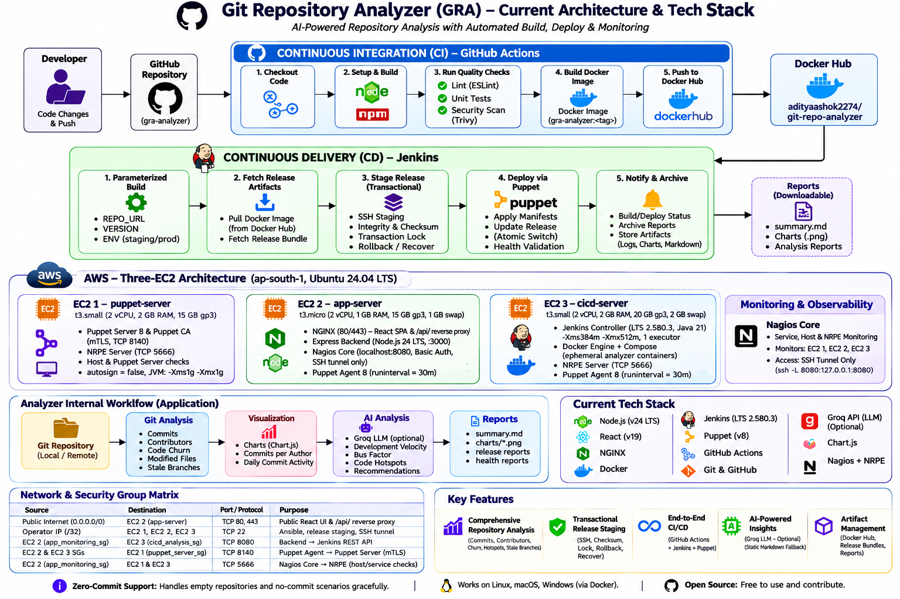
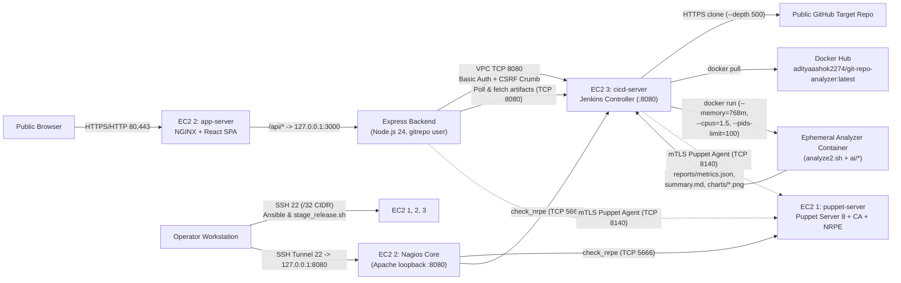

[](https://github.com/Aditya2274/Git-repo-analyzer/actions/workflows/docker-ci.yml)

# AI-Powered Git Repository Analyzer

An automated **Git Repository Analyzer and Operations Platform** that analyzes public GitHub repositories for commit activity, contributor concentration, Degree of Authorship (DOA) bus factor, code churn hotspots, stale branch drift, raster PNG charts, and Markdown architectural reports—backed by a React/TypeScript SPA, an Express/TypeScript API, a sandboxed Jenkins + Docker analyzer pipeline, transactional SSH release staging, Terraform/Ansible/Puppet infrastructure automation, and Nagios Core + NRPE monitoring.

---

## Table of Contents

- [Project Overview](#project-overview)
- [Architecture](#architecture)
  - [High-Level Topology](#high-level-topology)
  - [Continuous Integration (GitHub Actions)](#continuous-integration-github-actions)
  - [Continuous Delivery & Operational Automation (Jenkins)](#continuous-delivery--operational-automation-jenkins)
  - [Release Engineering](#release-engineering)
  - [AWS Infrastructure & Networking](#aws-infrastructure--networking)
  - [Monitoring (Nagios Core & NRPE)](#monitoring-nagios-core--nrpe)
- [Technology Stack](#technology-stack)
- [Features](#features)
- [Project Structure](#project-structure)
- [Installation and Usage](#installation-and-usage)
- [Release Packaging and Staging](#release-packaging-and-staging)
- [Infrastructure Provisioning](#infrastructure-provisioning)
- [Testing](#testing)
- [Deployment Status and Limitations](#deployment-status-and-limitations)
- [Security](#security)
- [License](#license)

---

## Project Overview

The Git Repository Analyzer extracts quantitative repository health telemetry and generates structured visual and Markdown reports for Git repositories:

- **Commit & Contributor Metrics**: Total commits, 7-day and 30-day commit counts, commits per author, insertions/deletions, and most modified files.
- **Deterministic Risk Models (`ai/metrics.js`)**:
  - **Bus Factor / Degree of Authorship (DOA)**: File-level ownership concentration risk (`DOA(e,f) = 3.293 + 1.098(FA) + 0.164(DL) - 0.321 * ln(1 + AC)`).
  - **Hotspot Volatility**: 30-day exponentially decayed code churn (`lambda = 0.05`) highlighting high-churn files.
  - **Branch Drift**: Feature branch divergence age, commits on main since split, and sync merges.
- **Visualizations & Reporting**: Headless Chart.js PNG charts (`commits_per_author.png`, `daily_commit_activity.png`) plus interactive React/Recharts cards, optional Groq LLM architectural insights via LangChain when `GROQ_API_KEY` is provided at runtime, and a deterministic static Markdown report (`reports/summary.md`) when no LLM key is present.
- **Dockerized Execution**: Portable Ubuntu 22.04 container packaging Bash, Git, Node.js 20 LTS, Cairo/Pango graphics libraries, Chart.js, and LangChain/Groq modules.

The platform is organized around **two distinct workflows** that must not be conflated:

1. **Analyzer Workflow (Target Repository Analysis)**
   Analyzes a user-supplied Git repository. A user submits a public `https://github.com/<owner>/<repo>` URL in the React UI (or mounts a local repository into the analyzer container directly). The Express backend validates the URL, dispatches a parameterized Jenkins build over the private VPC network, Jenkins clones the target repository and runs the sandboxed analyzer container, and the backend ingests the resulting `metrics.json`, `summary.md`, and PNG charts for display in the web dashboard.
2. **Release and Infrastructure Workflow (Platform Build, Staging & Management)**
   Builds, packages, deploys, and operates the analyzer platform itself:
   - **Image CI**: GitHub Actions builds, self-validates, and pushes the analyzer Docker image to Docker Hub.
   - **Application Release Pipeline**: Operator/automation scripts compile the React frontend and Express backend under Node.js 24 LTS, create dual SHA-256–verified tarballs, stream them over transactional SSH staging to the application server, and let Puppet atomically activate and health-check the release.
   - **Infrastructure Automation**: Terraform provisions three AWS EC2 instances in `ap-south-1`, Ansible bootstraps the OS and Puppet CA enrollment, Puppet enforces continuous desired state, and Nagios Core + NRPE monitor fleet health.

---

## Architecture



### High-Level Topology



### Continuous Integration (GitHub Actions)

Defined in [`.github/workflows/docker-ci.yml`](.github/workflows/docker-ci.yml) and triggered on pushes to `main` or `feat/deterministic-metrics` (plus manual `workflow_dispatch`), GitHub Actions runs a single sequential `build-and-push` job (`ubuntu-latest`, 20-minute timeout):

1. **Checkout Source**: Uses `actions/checkout@v4` with `fetch-depth: 0` so full Git history is available for analyzer self-validation.
2. **Version Tagging**: Generates `VERSION=1.0.${{ github.run_number }}`.
3. **Local Docker Build**: Builds `adityaashok2274/git-repo-analyzer:${VERSION}` and tags `:latest` from [`Dockerfile`](Dockerfile) with zero build arguments or baked-in secrets.
4. **Pre-Publish Container Validation**: Executes the newly built local `:latest` image against the checked-out repository (`docker run --rm -e GROQ_API_KEY="$GROQ_API_KEY" -v "$PWD":/repo ...`). If validation fails, the job halts immediately before Docker Hub authentication.
5. **Artifact Upload**: Uploads `reports/` as the `git-analyzer-report` workflow artifact (14-day retention).
6. **Docker Hub Publish**: Authenticates with `docker/login-action@v3` and pushes both `1.0.<run_number>` and `latest` strictly after container validation succeeds.

### Continuous Delivery & Operational Automation (Jenkins)

Jenkins runs on EC2 3 (`cicd-server`) and is managed by Puppet module [`puppet/modules/jenkins/`](puppet/modules/jenkins/manifests/init.pp) (Java 21 `openjdk-21-jre-headless`, Jenkins LTS `2.580.3` baseline, `-Xms384m -Xmx512m`, 1 built-in executor, inbound TCP/JNLP agent port disabled `-1`, `DefaultCrumbIssuer(true)` CSRF protection, `setAllowAnonymousRead(false)`).

The declarative [`Jenkinsfile`](Jenkinsfile) implements the parameterized repository analysis pipeline (`REPO_URL`, 15-minute global timeout, concurrent builds disabled):

1. **Validate Parameters & Storage**: Enforces `^https:\/\/github\.com\/[A-Za-z0-9_.-]+\/[A-Za-z0-9_.-]+(\.git)?$` and checks for at least 5 GB (`5242880` KB) free workspace disk space.
2. **Pull Latest Analyzer Image**: Pulls `adityaashok2274/git-repo-analyzer:latest` from Docker Hub.
3. **Clone Target Repository**: 5-minute timeout; clones with `-c core.hooksPath=/dev/null`, `--no-recurse-submodules`, and `--depth 500`; aborts and deletes `target-repo` if cloned size exceeds 2 GB (`2097152` KB).
4. **Run Git Repository Analyzer**: 10-minute timeout; mounts `$WORKSPACE/target-repo:/repo` into an isolated container (`--rm`, `--user "$(id -u):$(id -g)"`, `--memory=768m`, `--cpus=1.5`, `--pids-limit=100`, no `/var/run/docker.sock` mount, no Jenkins credentials, no `GROQ_API_KEY`). Uses the analyzer's deterministic static Markdown fallback.
5. **Archive Reports & Cleanup**: Archives `target-repo/reports/**/*` with fingerprinting (`allowEmptyArchive: false`), then stops/removes the named container, deletes `target-repo`, and runs `cleanWs` in `post`.

> **Note on Release Pipeline Scope:** Application release packaging ([`scripts/package_release.sh`](scripts/package_release.sh)) and transactional SSH staging ([`scripts/stage_release.sh`](scripts/stage_release.sh)) are implemented as standalone operator/CI CLI tools integrated with Puppet's `application::release` subsystem rather than as a second Jenkinsfile job.

### Release Engineering

Application releases for the React frontend and Express backend follow a transactional 11-step lifecycle spanning [`scripts/package_release.sh`](scripts/package_release.sh), [`scripts/stage_release.sh`](scripts/stage_release.sh), [`scripts/release-v67/`](scripts/release-v67/), and [`puppet/modules/application/`](puppet/modules/application/manifests/init.pp):

1. **Build Frontend and Backend**: Under strictly enforced Node.js 24 LTS, compiles TypeScript backend (`tsc -p tsconfig.build.json`) and Vite/React frontend (`tsc --noEmit && vite build`), and isolates backend production dependencies (`npm ci --omit=dev --ignore-scripts`).
2. **Assemble Release Bundle**: Copies `backend/dist`, `backend/package.json`, `backend/package-lock.json`, production `backend/node_modules`, `frontend/dist`, and `release-manifest.json` into a clean temporary directory—strictly rejecting `.env*`, `.git`, `src/`, `test/`, and devDependencies.
3. **Generate Versioned Archive & SHA-256 Sidecars**: [`scripts/release-v67/packaging_tx.sh`](scripts/release-v67/packaging_tx.sh) commits two hardlinked regular archives (`git-repo-analyzer-release-<VERSION>.tar.gz` and `<VERSION>.tar.gz`) plus `.sha256` sidecars under transaction locks and journals.
4. **Validate Release Artifacts**: Verifies hardlink inode identity, non-symlink regular file status, forbidden-key exclusion (`archiveSha256` prohibited in `release-manifest.json`), and `sha256sum -c --strict`.
5. **Transactional SSH Staging**: [`scripts/stage_release.sh`](scripts/stage_release.sh) delegates to [`scripts/release-v67/staging_tx.sh`](scripts/release-v67/staging_tx.sh), streaming `<VERSION>.tar.gz` exclusively over **SSH `stdin`** (zero `scp`) to an encoded, SHA-256–verified Python bootstrap on `app-server` while holding a per-version non-blocking kernel `flock` lock (`.gra-tx-<VERSION>.flock`) inside `/var/cache/git-repo-analyzer/staging`.
6. **Verify Remote Byte Count & SHA-256**: Remote execution reads exact `EXP_BYTES` (`head -c`), rejects truncated or trailing-byte streams, verifies `sha256sum` against `EXP_SHA`, and writes `0640` artifacts.
7. **Transactional Promotion & Journaling**: Records `manifest.env`, `tx_phase`, and per-artifact journals (`journal.ARCHIVE`, `journal.SIDECAR`); with `--overwrite`, backs up baseline files before atomic `mv -f -T` promotion, verifies post-promotion checksums, and retires transaction metadata with `AUTH_TAG` verification.
8. **Activate Release Through Puppet**: Puppet (`application::release` + [`release_manager.py`](puppet/modules/application/files/release_manager.py)) verifies `.sha256` sidecars and Hiera `application::expected_sha256`, extracts the bundle safely (`O_NOFOLLOW`, symlink/hardlink/device-node rejection), stamps `<meta name="app-release-id">`, activates NGINX `503 MAINTENANCE` mode via `maintenance.flag`, atomically switches `/opt/git-repo-analyzer/current -> /opt/git-repo-analyzer/releases/<VERSION>`, and restarts `git-repo-analyzer-backend.service`.
9. **Backend & Frontend Health Checks**: [`health_check.py`](puppet/modules/application/files/health_check.py) probes `http://127.0.0.1:3000/api/health` and the internal loopback NGINX verification server (`127.0.0.1:8081`) to confirm `status: UP` and identical `releaseId` / `X-App-Release` and `<meta name="app-release-id">` values before promoting `previousKnownGood`, removing `maintenance.flag`, and pruning old releases (retaining 3 by default).
10. **Automatic Rollback**: Staging failures during `--overwrite` automatically restore baseline backups (`TX_ROLLED_BACK_VERIFIED`); Puppet activation or health-gate failures trigger `--revert-on-fail`, restoring the prior known-good `current` symlink and restarting services.
11. **Transaction Recovery**: Interrupted or `TX_RECOVERY_REQUIRED` staging transactions can be explicitly recovered via `scripts/stage_release.sh --recover --version <VERSION> --tx-token <TOKEN>` (and packaging transactions via `--recover` in `packaging_tx.sh`), validated by `TX_ID` binding and cryptographic `AUTH_TAG`.

### AWS Infrastructure & Networking

Defined in [`terraform/main.tf`](terraform/main.tf) and [`terraform/modules/ec2/main.tf`](terraform/modules/ec2/main.tf) for AWS region `ap-south-1` using Ubuntu 24.04 LTS AMIs resolved dynamically from AWS SSM Parameter Store and 50 GB total encrypted `gp3` EBS storage:

| Server | Instance Type | EBS (`gp3`) | Swap | Responsibilities |
|---|---|---|---|---|
| **Puppet Server** (`puppet-server`) | `t3.small` | 15 GB | 0 GB | Puppet Server 8, Puppet CA (`autosign = false`), NRPE (`nagios-nrpe-server`) |
| **App Server** (`app-server`) | `t3.micro` | 15 GB | 1 GB | NGINX reverse proxy & SPA static hosting, React frontend, Node.js 24 Express backend, Puppet Agent 8, Nagios Core (`nagios4` + Apache loopback), NRPE client (`check_nrpe`) |
| **CI/CD Server** (`cicd-server`) | `t3.small` | 20 GB | 2 GB | Jenkins Controller (Java 21), Docker Engine & Compose plugin, ephemeral analyzer containers, Puppet Agent 8, NRPE (`nagios-nrpe-server`) |

All three instances launch in Default VPC public subnets (`associate_public_ip_address = true`) for direct outbound Internet access (`apt`, Docker Hub, GitHub) without a NAT Gateway, while directional AWS Security Groups lock down all ingress:

| Port / Protocol | Source | Destination | Purpose |
|---|---|---|---|
| `80`, `443` / TCP | `0.0.0.0/0` | EC2 2 (`app_monitoring_sg`) | Public React SPA & `/api/` reverse proxy |
| `22` / TCP | Operator IP `/32` (`var.allowed_ssh_cidr`) | EC2 1, EC2 2, EC2 3 | SSH management, Ansible, release staging, Nagios SSH tunnel |
| `8080` / TCP | EC2 2 (`app_monitoring_sg`) | EC2 3 (`cicd_analysis_sg`) | Express `LiveJenkinsClient` $\rightarrow$ Jenkins REST API |
| `8140` / TCP | EC2 2 & EC2 3 SGs | EC2 1 (`puppet_server_sg`) | Puppet Agent $\rightarrow$ Puppet Server mTLS catalog pulls |
| `5666` / TCP | EC2 2 (`app_monitoring_sg`) | EC2 1 & EC2 3 | Nagios Core `check_nrpe` $\rightarrow$ remote NRPE checks |

### Monitoring (Nagios Core & NRPE)

Monitoring is implemented exclusively with **Nagios Core** and **NRPE** via [`puppet/modules/nagios/`](puppet/modules/nagios/manifests/init.pp) and [`puppet/modules/nrpe/`](puppet/modules/nrpe/manifests/init.pp):

- **Nagios Core (`app-server`, EC2 2)**:
  - Monitors local `app-server` disk space (`/`), CPU load, running processes, and NGINX port `80` (`check_http_port!80`).
  - Polls remote nodes over TCP `5666` (`check_nrpe`, `dont_blame_nrpe=0`, zero arbitrary arguments):
    - `puppet-server` (EC2 1): `NRPE Connectivity` (`check_load`), `Puppet Server Service` (`check_puppetserver.sh`).
    - `cicd-server` (EC2 3): `NRPE Connectivity` (`check_load`), `Jenkins Service` (`check_jenkins.sh`), `Docker Service` (`check_docker.sh`).
  - Served by Apache (`apache2`) bound strictly to `127.0.0.1:8080` with HTTP Basic Auth (`/etc/nagios4/htpasswd.users`, `root:www-data`, `0640`). NGINX never proxies `/nagios`. Operators access the UI exclusively over an encrypted SSH tunnel (`ssh -L 8080:127.0.0.1:8080`).
- **NRPE (`puppet-server` & `cicd-server`)**:
  - `nagios-nrpe-server` listens on TCP `5666` with `allowed_hosts` restricted to loopback and `app-server`, exposing baseline system checks (`check_users`, `check_load`, `check_disk`, `check_zombie_procs`, `check_total_procs`) plus node-targeted service scripts.

---

## Technology Stack

| Layer | Technology | Role in Repository |
|---|---|---|
| **Analyzer CLI & Scripting** | **Bash** (`analyze2.sh`) | Interactive menu, zero-commit guard, Git stat extraction, orchestrates Node.js metric/chart/report modules |
| **Version Control Inspection** | **Git** | Local/remote history traversal (`git log`, `git shortlog`, `git for-each-ref`, `--numstat`) and shallow sandboxed cloning |
| **Backend & Tooling Runtime** | **Node.js** | **20 LTS** inside the analyzer Docker container (`Dockerfile`); **24 LTS** for Express API, Vite builds, and `scripts/package_release.sh` |
| **Frontend UI** | **React** (`18.3`, TypeScript, Vite, Tailwind CSS, Recharts, `react-markdown`) | Production SPA serving submission form, adaptive polling (`2s`–`10s`), metric/hotspot/DOA/branch cards, PNG chart viewer, and Markdown report rendering |
| **Backend API** | **Express** (`4.21`, TypeScript, Zod) | REST API (`/api/health`, `/api/analyses`, `/api/analyses/:id`, `/api/analyses/:id/results`, `/api/analyses/:id/charts/:name`), SSRF/URL validation, `FileAnalysisStore` JSON persistence, `LiveJenkinsClient`/`MockJenkinsClient`, `ArtifactIngestor` |
| **Charting** | **Chart.js** (`chart.js`, `chartjs-node-canvas`) | Headless Cairo/Pango PNG chart generation inside the analyzer container (`commits_per_author.png`, `daily_commit_activity.png`) |
| **AI Insights (Optional)** | **LangChain** (`@langchain/core`, `@langchain/groq`) & **Groq API** | Converts deterministic `metrics.json` into architectural Markdown insights when `GROQ_API_KEY` is injected at runtime |
| **Containerization** | **Docker** | Packages the analyzer runtime (`Dockerfile`), runs sandboxed ephemeral analysis containers on EC2 3 (`docker-ce` + Compose plugin) |
| **Continuous Integration** | **GitHub Actions** | Validates analyzer container against source repo before pushing tags to Docker Hub (`.github/workflows/docker-ci.yml`) |
| **Container Registry** | **Docker Hub** | Distributes validated `adityaashok2274/git-repo-analyzer` images (`latest` & `1.0.<run_number>`) |
| **CD & Analysis Execution** | **Jenkins** (`Jenkinsfile`, LTS `2.580.3` baseline) | Parameterized (`REPO_URL`) private pipeline controller executing sandboxed Git clones and Docker analyzer runs |
| **Cloud Infrastructure** | **AWS EC2** & **AWS S3** | 3-EC2 Ubuntu 24.04 fleet in `ap-south-1`; S3 bucket (`git-repo-analyzer-terraform-state-2026`) stores remote Terraform state with native lockfile |
| **Infrastructure as Code** | **Terraform** (`hashicorp/aws ~> 6.0`) | Provisions VPC EC2 instances, directional Security Groups, SSM AMI lookup, and `ansible_inventory_template` |
| **Bootstrap & Orchestration** | **Ansible** | Agentless SSH bootstrap: dynamic inventory sync, console SSH host-key trust, swap, `/etc/hosts`, Puppet Server/CA setup, controlled CSR enrollment, Docker CE, baseline NGINX |
| **Desired-State & Release Activation** | **Puppet** (`8.x`) | Pull-based mTLS (`8140`) convergence: manages `common`, `nrpe`, `nagios`, `jenkins`, and `application` (Node 24, systemd backend, NGINX vhost, transactional release activation & rollback) |
| **Web & Reverse Proxy** | **NGINX** | Public `80`/`443` static SPA server, `503 MAINTENANCE` gate, and `/api/` reverse proxy to Express (`127.0.0.1:3000`) |
| **Monitoring** | **Nagios Core** & **NRPE** | Central active monitoring on EC2 2 (`127.0.0.1:8080` Apache loopback) + remote service/system checks over TCP `5666` on EC2 1 and EC2 3 |

---

## Features

### Repository Analyzer & Web Platform Features
- **Commit History Metrics**: Total commits, commits in the last 7 and 30 days, and contributor breakdown (`git shortlog`).
- **Code Churn & Most Modified Files**: Total insertions/deletions, top modified files, and 30-day exponentially weighted hotspot volatility scores (`ai/metrics.js`).
- **Bus Factor (DOA) & Stale Branch Detection**: Computes file-level author concentration (`DOA`) and branch divergence drift against the main branch.
- **Visual Activity Charts**: Generates `commits_per_author.png` (bar) and `daily_commit_activity.png` (line) via Chart.js, rendered alongside interactive Recharts cards in the React UI.
- **AI Architectural Insights + Static Markdown Fallback**: Uses LangChain + Groq API when `GROQ_API_KEY` is set; automatically writes a complete deterministic Markdown report when `GROQ_API_KEY` is absent or an API call fails.
- **Zero-Commit Repository Support**: Detects `ZERO_COMMITS=true` cleanly (`git rev-parse HEAD`), skips charts gracefully, and avoids `fatal: ambiguous argument 'HEAD'`.
- **Dockerized & Interactive Modes**: Supports headless CI/Jenkins execution (`[ ! -t 0 ]`) and an interactive 4-option terminal menu (`Run Full Analysis`, `Generate Charts Only`, `Show Commit Summary`, `Exit`).
- **Web Application Isolation & Persistence**: Exposes strictly application UUID v4 `analysisId` values (never leaking Jenkins `queueId` or `buildNumber`), validates URLs against SSRF/DNS rebinding/redirects, and recovers persisted job state across backend restarts via atomic JSON writes.

### Release Engineering Features
- **Reproducible, Secret-Free Release Bundles**: Packages compiled `backend/dist`, `frontend/dist`, production `node_modules`, and `release-manifest.json` while failing closed on `.env*`, `.git`, `src/`, `test/`, or devDependencies.
- **Dual Hardlinked Archives & SHA-256 Sidecars**: Produces both `git-repo-analyzer-release-<VERSION>.tar.gz` and hardlinked `<VERSION>.tar.gz` with strict GNU `.sha256` sidecars.
- **Transactional SSH `stdin` Staging**: Streams archives over SSH `stdin` without `scp`, verifies exact byte counts and SHA-256 digests, acquires per-version `flock` locks, maintains `manifest.env` + journals, supports `--overwrite` backup/rollback, and provides `--recover --tx-token` recovery.
- **Atomic Puppet Activation & Health Gating**: Performs `O_NOFOLLOW` archive checks, stamps frontend `<meta name="app-release-id">`, enables NGINX `503 MAINTENANCE` mode, atomically swaps `/opt/git-repo-analyzer/current`, verifies backend & loopback NGINX parity (`127.0.0.1:8081`), auto-reverts on failure, and prunes older releases.

---

## Project Structure

```text
Git-repo-analyzer/
├── .github/
│   └── workflows/
│       └── docker-ci.yml                 # GitHub Actions CI: build, validate container, push to Docker Hub
├── ai/                                   # Analyzer Node.js reporting & visualization modules
│   ├── chartGenerator.js                 # Chart.js PNG generator (author bar & daily activity line charts)
│   ├── metrics.js                        # Deterministic DOA bus factor, 30d hotspots, and branch drift engine
│   ├── prompt.js                         # Architectural review prompt builder for Groq LLM
│   ├── reportGenerator.js                # Groq/LangChain orchestration + static Markdown fallback
│   └── providers/
│       └── groqProvider.js               # ChatGroq client wrapper
├── analyze2.sh                           # Core Bash analyzer CLI (interactive & non-interactive container entrypoint)
├── Dockerfile                            # Ubuntu 22.04 + Git + Node.js 20 LTS + Cairo/Pango + Chart.js/LangChain
├── Jenkinsfile                           # Parameterized (REPO_URL), sandboxed Jenkins analysis pipeline
├── git-repo-analyzer-updated.png         # Architecture diagram
├── README.md
├── AGENTS.md                             # Project architecture & governance specification
├── backend/                              # Express + TypeScript + Zod REST API
│   ├── package.json
│   ├── tsconfig.json
│   ├── tsconfig.build.json
│   ├── src/
│   │   ├── app.ts                        # Express middleware, security headers, CORS, JSON error handler
│   │   ├── server.ts                     # Bootstrapping, store recovery, Mock/Live Jenkins selection, graceful shutdown
│   │   ├── config/env.ts                 # Zod environment parser & fail-closed production guards
│   │   ├── routes/
│   │   │   ├── analyses.ts               # /api/analyses, /:id, /:id/results, /:id/charts/:name
│   │   │   └── health.ts                 # /api/health with startup releaseId & X-App-Release header
│   │   ├── services/
│   │   │   ├── analysisManager.ts        # Submission, UUID mapping, async polling, restart recovery
│   │   │   ├── analysisStore.ts          # Atomic JSON disk persistence (FileAnalysisStore)
│   │   │   ├── artifactIngestion.ts      # Zod schema, size, path & PNG magic-byte validation
│   │   │   ├── jenkinsClient.ts          # IJenkinsClient interface
│   │   │   ├── liveJenkinsClient.ts      # Same-origin Jenkins REST client (Basic Auth + CSRF crumb)
│   │   │   └── mockJenkinsClient.ts      # Deterministic mock client for local development/testing
│   │   ├── types/analysis.ts
│   │   ├── utils/errors.ts
│   │   └── validators/
│   │       ├── ipGuard.ts                # Public IPv4/IPv6 checks (blocks loopback/link-local/RFC1918/IMDS)
│   │       └── repoValidator.ts          # Strict HTTPS github.com URL + DNS pinning + redirect SSRF guard
│   └── test/                             # 8 backend unit & Jenkins protocol integration test suites
├── frontend/                             # React 18 + Vite + Tailwind + Recharts SPA
│   ├── .env.example
│   ├── index.html
│   ├── package.json
│   ├── vite.config.ts
│   ├── tailwind.config.js
│   ├── src/
│   │   ├── App.tsx                       # Main workflow, health check, session history, URL query sync
│   │   ├── api/client.ts                 # Relative /api/* HTTP client & PNG blob fetcher
│   │   ├── components/
│   │   │   ├── ActivityCharts.tsx        # Raster PNG charts & Recharts visualizations
│   │   │   ├── AnalysisProgress.tsx      # QUEUED/BUILDING/terminal state feedback
│   │   │   ├── MarkdownReport.tsx        # Safe AST react-markdown + remark-gfm viewer
│   │   │   ├── MetricCards.tsx           # Repository, DOA, hotspot, and branch drift cards
│   │   │   └── RepoInputForm.tsx         # GitHub HTTPS URL submission form
│   │   ├── hooks/useAnalysisPolling.ts   # Adaptive 2s->10s backoff polling hook (10m ceiling)
│   │   └── types/analysis.ts
│   └── test/                             # 5 Vitest + Testing Library frontend test files
├── scripts/
│   ├── package_release.sh                # Node.js 24 production build & release packager wrapper
│   ├── stage_release.sh                  # Transactional SSH stdin release stager wrapper
│   └── release-v67/                      # Transactional packaging & staging engine + fault-injection suite
│       ├── design_common.sh
│       ├── packaging_tx.sh
│       ├── staging_tx.sh
│       └── run_design_tests.sh
├── cicd/
│   └── tests/                            # CI/CD, sandboxing, packaging, and staging test suites
│       ├── test_checkpoint_7_1.sh
│       ├── test_checkpoint_7_4.sh
│       ├── test_docker_ci_workflow.sh
│       ├── test_package_release.sh
│       └── test_stage_release.sh
├── terraform/                            # AWS ap-south-1 3-EC2 provisioning & S3 remote state backend
│   ├── main.tf
│   ├── variables.tf
│   ├── output.tf
│   └── modules/ec2/
│       ├── main.tf
│       ├── outputs.tf
│       └── variables.tf
├── ansible/                              # Day-0/1 SSH bootstrap, CA enrollment, Docker & baseline NGINX
│   ├── ansible.cfg
│   ├── inventory/
│   │   ├── hosts.ini
│   │   └── group_vars/
│   ├── playbooks/
│   │   ├── site.yml
│   │   ├── enroll-puppet-agents.yml
│   │   └── test-*.yml
│   ├── roles/
│   │   ├── common/
│   │   ├── puppet_server/
│   │   ├── puppet_agent/
│   │   ├── docker/
│   │   └── nginx/
│   ├── scripts/
│   │   ├── sync_terraform_inventory.sh
│   │   └── verify_ssh_host_keys.sh
│   └── tests/                            # 8 Ansible role & script test suites
├── puppet/                               # Steady-state Puppet 8 manifests, Hiera v5, and release activation
│   ├── hiera.yaml
│   ├── hieradata/common.yaml
│   ├── manifests/site.pp
│   ├── modules/
│   │   ├── common/
│   │   ├── nrpe/
│   │   ├── nagios/
│   │   ├── jenkins/
│   │   └── application/                  # Node 24, systemd backend, NGINX vhost, release_manager.py, health_check.py
│   └── tests/                            # 8 Puppet syntax, catalog, DAG, and convergence test suites
└── project_docs/                         # Architecture decisions, status, handover, packaging/staging & work logs
```

---

## Installation and Usage

### Prerequisites

| Use Case | Required Tools & Versions |
|---|---|
| **Docker Analyzer Execution** | Docker Engine (`docker run`) |
| **Native Analyzer CLI (`analyze2.sh`)** | Git, Bash, **Node.js 20+** and `npm` (Node.js 20 LTS is used inside [`Dockerfile`](Dockerfile)) |
| **Web App Build & Release Packaging** | **Node.js 24 LTS** (`^v?24(\.\|$)`, strictly enforced by `scripts/package_release.sh`), `npm`, `tar`, `sha256sum`, `git` |
| **Release Staging (`stage_release.sh`)** | `bash`, OpenSSH client (`ssh`), `python3`, `base64`, `sha256sum` |
| **Infrastructure & Automation** | Terraform (`hashicorp/aws ~> 6.0`), Ansible (`2.16+`), Puppet (`8.x`), AWS CLI |

### 1. Docker Analyzer Execution (Recommended)

Pull and run the container against any local Git repository mounted at `/repo`:

```bash
docker pull adityaashok2274/git-repo-analyzer:latest

# Deterministic static Markdown report + PNG charts + metrics.json
docker run --rm -it \
  --user "$(id -u):$(id -g)" \
  -v "$(pwd)":/repo \
  adityaashok2274/git-repo-analyzer:latest
```

To enable Groq LLM architectural insights at runtime (optional):

```bash
docker run --rm \
  --user "$(id -u):$(id -g)" \
  -e GROQ_API_KEY="$GROQ_API_KEY" \
  -e GROQ_MODEL="groq/compound-mini" \
  -v "$(pwd)":/repo \
  adityaashok2274/git-repo-analyzer:latest
```

- When standard input is a TTY, `analyze2.sh` opens the 4-option interactive menu (`1) Run Full Analysis`, `2) Generate Charts Only`, `3) Show Commit Summary`, `4) Exit`).
- When stdin is non-interactive (`[ ! -t 0 ]`), `analyze2.sh` automatically runs the full analysis and exits `0`.

### 2. Native Analyzer Execution

```bash
chmod +x analyze2.sh
./analyze2.sh
```

If `chartjs-node-canvas` is absent locally, `analyze2.sh` installs `chartjs-node-canvas`, `chart.js`, `dotenv`, `@langchain/groq`, and `@langchain/core` (`--no-save`) before executing `/tool/ai/chartGenerator.js` / `/tool/ai/reportGenerator.js` (note: `analyze2.sh` references `/tool/ai/*.js` for container paths; Docker execution is recommended).

### 3. Analyzer Output Locations

Inside the analyzed repository root:

- `reports/metrics.json` — Structured repository, DOA bus factor, 30-day hotspot, and branch drift JSON metrics
- `reports/summary.md` — Final Markdown architectural report (AI-generated or deterministic static fallback)
- `reports/charts/commits_per_author.png` — Bar chart of commits per author
- `reports/charts/daily_commit_activity.png` — Line chart of daily commit frequency

### 4. Local Web Application (Mock Jenkins Mode)

```bash
# Terminal 1 — Express Backend API (http://127.0.0.1:3000)
npm --prefix backend ci
npm --prefix backend run build
NODE_ENV=development JENKINS_MOCK_MODE=true npm --prefix backend start

# Terminal 2 — React Vite Dev Server (http://127.0.0.1:5173, proxies /api -> :3000)
npm --prefix frontend ci
npm --prefix frontend run dev
```

*(Never use `vite` dev server in production; production builds are served as static files by NGINX.)*

### 5. Environment Variables

**Analyzer Runtime (`ai/reportGenerator.js`, `ai/providers/groqProvider.js`)**

| Variable | Default | Purpose |
|---|---|---|
| `GROQ_API_KEY` | *(unset)* | Runtime-only Groq API key; if unset, writes deterministic static `reports/summary.md` |
| `GROQ_MODEL` | `groq/compound-mini` | Groq model identifier passed to `ChatGroq` |
| `REPORT_PATH` | `reports/summary.md` | Destination Markdown report path |

**Backend API (`backend/src/config/env.ts` & `/etc/git-repo-analyzer/backend.env`)**

| Variable | Default | Purpose |
|---|---|---|
| `NODE_ENV` | `development` | `development`, `test`, or `production` |
| `PORT` | `3000` | Express loopback listening port |
| `HOST` | `127.0.0.1` | Express bind host |
| `DATA_DIR` | `<cwd>/data` | Persistent storage for `analyses.json` and cached PNG artifacts (`/var/lib/git-repo-analyzer/data` in prod) |
| `CORS_ORIGIN` | `http://localhost:5173` (dev) / `""` (prod) | Comma-separated allowed `http`/`https` origins (must be populated in production) |
| `SSRF_CHECK_DNS` | `true` | Enforces DNS + public IP SSRF check (cannot be `false` when `NODE_ENV=production`) |
| `ANALYSIS_TIMEOUT_MS` | `600000` | Maximum job duration before failure timeout (ms) |
| `POLL_INTERVAL_MS` | `1500` | Backend Jenkins polling interval (ms) |
| `JENKINS_MOCK_MODE` | `true` | `true` uses `MockJenkinsClient`; `false` uses `LiveJenkinsClient` |
| `JENKINS_URL` | *(unset)* | Private Jenkins URL (`http://<cicd-server-private-ip>:8080`, required when `JENKINS_MOCK_MODE=false`) |
| `JENKINS_USER` | *(unset)* | Jenkins service account username (e.g., `backend-service`) |
| `JENKINS_API_TOKEN` | *(unset)* | Jenkins API token provisioned out-of-band in `/etc/git-repo-analyzer/backend.env` (`0640`) |
| `JENKINS_JOB_NAME` | `git-repo-analyzer` | Parameterized Jenkins job name |
| `JENKINS_REQUEST_TIMEOUT_MS` | `5000` | Timeout per Jenkins REST HTTP request (ms) |

**Frontend (`frontend/.env.example`)**

| Variable | Default | Purpose |
|---|---|---|
| `VITE_API_BASE_URL` | *(empty)* | Keep empty so requests use relative `/api/...` routes via Vite proxy (dev) or NGINX (prod) |

### 6. Jenkins Parameterized Execution

When configured on EC2 3 (`cicd-server`), trigger the `git-repo-analyzer` pipeline job with:

- **Parameter**: `REPO_URL` (e.g., `https://github.com/octocat/Hello-World.git`)
- **Enforced Limits**:
  - Anchored HTTPS `github.com` regex check
  - Pre-clone workspace free-space gate: $\ge 5\text{ GB}$
  - Shallow clone (`--depth 500`, `--no-recurse-submodules`, `-c core.hooksPath=/dev/null`, 5-minute timeout) and $\le 2\text{ GB}$ post-clone size ceiling
  - Container sandbox: `--rm`, `--user "$(id -u):$(id -g)"`, `--memory=768m`, `--cpus=1.5`, `--pids-limit=100`, 10-minute timeout, zero `/var/run/docker.sock`, zero Jenkins credentials or `GROQ_API_KEY`
  - Reports archived from `target-repo/reports/**/*`, followed by container/workspace cleanup

---

## Release Packaging and Staging

Detailed guides live in [`project_docs/RELEASE_PACKAGING.md`](project_docs/RELEASE_PACKAGING.md) and [`project_docs/RELEASE_STAGING.md`](project_docs/RELEASE_STAGING.md).

### 1. Packaging (`scripts/package_release.sh`)

```bash
# Standard build and package
scripts/package_release.sh 1.0.0

# Explicit options or skip rebuild when dist/ is current
scripts/package_release.sh -v 1.0.0 -o ./dist-release
scripts/package_release.sh -v 1.0.0 --skip-build
```

**CLI Options:**
- `-v, --version <VERSION>`: Required release ID matching `^[A-Za-z0-9][A-Za-z0-9._-]{0,127}$` without `..`
- `-o, --output-dir <DIR>`: Destination directory (default: `<PROJECT_ROOT>/dist-release`, chmod `0700`)
- `-s, --skip-build`: Skip `npm run build` for backend and frontend
- `-h, --help`: Show usage

**Outputs (dual hardlinked archives + GNU coreutils SHA-256 sidecars):**
- `git-repo-analyzer-release-<VERSION>.tar.gz` & `.sha256`
- `<VERSION>.tar.gz` & `.sha256` (hardlinked regular file sharing the exact inode so Puppet `release_manager.py` rejects symlinks cleanly)

### 2. Transactional SSH Staging (`scripts/stage_release.sh`)

```bash
# Stage release archive over SSH stdin to app-server
scripts/stage_release.sh \
  --version 1.0.0 \
  --archive-dir ./dist-release \
  --host app-server \
  --user ubuntu \
  --identity ~/.ssh/git-repo-analyzer.pem \
  --ssh-config ./ansible/ssh.cfg \
  --remote-dir /var/cache/git-repo-analyzer/staging

# Overwrite an existing staged version (with backup/rollback protection)
scripts/stage_release.sh -v 1.0.0 --overwrite

# Recover an interrupted or TX_RECOVERY_REQUIRED transaction
scripts/stage_release.sh --recover --version 1.0.0 --tx-token <SESSION_TOKEN>
```

**CLI Options & Environment Overrides (`STAGE_*`):**
- `-v, --version <VERSION>` (`STAGE_ARCHIVE_DIR` for `-d, --archive-dir`)
- `-H, --host` (`STAGE_SSH_HOST`, default `app-server`)
- `-u, --user` (`STAGE_SSH_USER`, default `ubuntu`)
- `-p, --port` (`STAGE_SSH_PORT`, default `22`)
- `-i, --identity` (`STAGE_SSH_KEY`, auto-detects `~/.ssh/git-repo-analyzer.pem` if present)
- `-F, --ssh-config` (`STAGE_SSH_CONFIG`, auto-detects `./ssh.cfg` or `./ansible/ssh.cfg` if present)
- `-r, --remote-dir` (`STAGE_REMOTE_DIR`, default `/var/cache/git-repo-analyzer/staging`)
- `--overwrite`: Permit transactional replacement with backup & automatic rollback (cannot combine with `--recover`)
- `--recover` & `--tx-token <TOKEN>`: Explicit recovery mode authorized against `TX_ID` and `AUTH_TAG` (`SHA-256(version:tx_id:token)[:32]`)

**Engine Guarantees (`scripts/release-v67/`):**
- **No `scp` / No Remote Shell Interpolation**: Streams binary tarballs over SSH `stdin` while sending a Base64-encoded script and JSON argument list verified via SHA-256 digests (`exit 71` on mismatch) to `/usr/bin/python3`, which invokes `/bin/bash -c` via `os.execv`.
- **Kernel Locking & Link Protections**: Opens `.gra-tx-<VERSION>.flock` with `O_CREAT | O_RDWR | O_NOFOLLOW`, asserts `st_nlink == 1`, `st_uid == euid`, post-`flock` `lstat`/`fstat` inode parity, and non-blocking `LOCK_EX | LOCK_NB` (`exit 75` `MUTEX_BUSY` on contention).
- **Journals, Rollback & Recovery**: Tracks `manifest.env` (`SCHEMA_VERSION=1`), `tx_phase`, and `journal.ARCHIVE`/`journal.SIDECAR`; restores baseline backups non-destructively on post-upload or promotion errors, or enters `TX_RECOVERY_REQUIRED` preserving backup evidence until explicit `--recover --tx-token`.

---

## Infrastructure Provisioning

1. **Terraform (`terraform/`)** — Provisions the three EC2 instances (`puppet-server`, `app-server`, `cicd-server`), directional Security Groups, encrypted `gp3` volumes, and `ansible_inventory_template` output in `ap-south-1`. Remote state is configured on AWS S3 (`bucket = "git-repo-analyzer-terraform-state-2026"`, `key = "git-repo-analyzer/terraform.tfstate"`, `region = "ap-south-1"`, `encrypt = true`, `use_lockfile = true`).
2. **Ansible (`ansible/`)** — Day-0/1 push orchestration over SSH (`22`):
   - `ansible/scripts/sync_terraform_inventory.sh`: Atomically populates `ansible/inventory/hosts.ini` from Terraform outputs.
   - `ansible/scripts/verify_ssh_host_keys.sh`: Verifies EC2 host keys against EC2 serial console logs (`aws ec2 get-console-output`) into git-ignored `ansible/known_hosts` (`0600`).
   - `ansible/playbooks/site.yml`: Applies `common` (non-blocking POSIX `fcntl.lockf` APT wait, `/etc/hosts`, per-node swap), `puppet_server` (Puppet Server 8, `-Xms1g -Xmx1g`, CA init, `autosign = false`), `puppet_agent` (installed stopped/disabled), `docker` (EC2 3 Docker CE + log rotation), and `nginx` baseline (EC2 2).
   - `ansible/playbooks/enroll-puppet-agents.yml`: 9-step controlled enrollment allowlisting `app-server` and `cicd-server` for individual CA signing (`puppetserver ca sign --certname ...`), supervised first catalog run (`--detailed-exitcodes`), and `puppet` daemon activation.
3. **Puppet (`puppet/`)** — Day-2+ pull convergence (`runinterval = 30m` over mTLS TCP `8140`):
   - [`puppet/manifests/site.pp`](puppet/manifests/site.pp) classifies:
     - `puppet-server`: `common` $\rightarrow$ `nrpe::server`
     - `app-server`: `common` $\rightarrow$ `nrpe::client` $\rightarrow$ `nagios` $\rightarrow$ `application`
     - `cicd-server`: `common` $\rightarrow$ `nrpe::server` $\rightarrow$ `jenkins`
   - `application` deploys Node.js 24 LTS, extracts/verifies staged releases (`release_manager.py`), manages `git-repo-analyzer-backend.service` (`gitrepo:gitrepo`) and `/etc/git-repo-analyzer/backend.env` (`0640`), replaces the NGINX baseline with the production SPA + `/api/` proxy + `503 MAINTENANCE` gate, and runs loopback release parity verification (`health_check.py`).

---

## Testing

### Recently Verified Test Suites (Local & Simulated)

| Suite / Command | Result | Scope & Validation Boundary |
|---|---|---|
| `cicd/tests/test_package_release.sh` | **10/10 PASS** | **Local real build**: CLI validation, Node.js 24 guard, real frontend/backend production build, hardlink + SHA-256 sidecar checks, archive isolation, direct Python validation via `release_manager.py` |
| `cicd/tests/test_stage_release.sh` | **22/22 PASS** | **Simulated / mocked SSH**: runs against a local `mktemp` sandbox with a mocked `ssh` stub (`eval`) and failing `scp` stub; validates CLI, stream truncation/corruption, lock anchors, `--overwrite` rollback, and `--recover` |
| `scripts/release-v67/run_design_tests.sh` | **106/106 PASS** | **Simulated / mocked SSH & fault injection**: tests Base64/JSON argument serialization, `O_NOFOLLOW`/hardlink rejection, `write_state_atomic` exit codes `1`/`2`, failure hooks, `TX_RECOVERY_REQUIRED`, and `AUTH_TAG` recovery |
| `cicd/tests/test_docker_ci_workflow.sh` | **8/8 PASS** | **Local static/semantic check**: PyYAML inspection of `.github/workflows/docker-ci.yml` verifying triggers, `fetch-depth: 0`, validation-before-push ordering, and runtime-only `GROQ_API_KEY` |
| `npm --prefix backend test` | **27/27 PASS** | **Local unit + loopback simulator**: Express endpoints, URL/SSRF guards, `FileAnalysisStore` recovery, `ArtifactIngestor`, and `LiveJenkinsClient` against a stateful loopback HTTP simulator |
| `npm --prefix frontend test` | **14/14 PASS** | **Local unit/DOM (Vitest + jsdom)**: submission validation, adaptive polling, markdown rendering, and workflow states |
| `ansible/tests/test_sync_inventory.sh` & `test_verify_ssh_keys.sh` | **5/5 PASS**, **8/8 PASS** | **Local fixture/mocked CLI**: inventory parsing and EC2 serial console fingerprint comparison logic |
| `puppet/tests/test_puppet_architecture.sh` | **15/15 PASS** | **Local Puppet parser/syntax**: node layout, Hiera bindings, and Ansible playbook syntax checks |
| `terraform -chdir=terraform fmt -check && validate` | **PASS** | **Local HCL syntax & module validation** (does not contact AWS or provision resources) |

### Additional Local Regression Suites Recorded in `project_docs/`
- [`project_docs/PROJECT_STATUS.md`](project_docs/PROJECT_STATUS.md) and [`project_docs/WORK_LOG.md`](project_docs/WORK_LOG.md) additionally record passing local fixture/container runs for `cicd/tests/test_checkpoint_7_1.sh` (25/25), `cicd/tests/test_checkpoint_7_4.sh` (13/13), `puppet/tests/test_jenkins_module.sh` (21/21), Phase 4 Ansible role/enrollment suites (208/208), Phase 5A Puppet suites (83/83), and Phase 5B Puppet application/release suites (62/62).

### Validation Boundary Summary

- **Local Automated Coverage**: Packaging, backend API, frontend SPA, Puppet syntax/catalog compilation, Terraform validation, and container analyzer execution have been verified locally.
- **Simulated SSH Tests**: `test_stage_release.sh` and `run_design_tests.sh` use a mocked `ssh` binary in local temporary directories; they verify engine state machines and failure-injection paths, not real TCP/SSH transport.
- **Actual OpenSSH Validation**: Real OpenSSH daemon interaction, `ansible/known_hosts` enforcement, and mid-transfer network interruption over TCP port `22` have **not** yet been tested against live hosts.
- **Real EC2 Deployment Validation**: End-to-end execution across the 3 AWS EC2 instances has **not** yet been performed.

---

## Deployment Status and Limitations

### Current Verified State

- **AWS Infrastructure (`ap-south-1`)**: Verified via read-only AWS CLI checks (`aws ec2 describe-instances --region ap-south-1` returned `[]`, 0 EC2 instances; `aws s3 ls s3://git-repo-analyzer-terraform-state-2026/ --recursive` confirmed the S3 state bucket exists and currently holds 0 objects because `terraform apply` has not been executed).
- **Docker Hub Image (`adityaashok2274/git-repo-analyzer`)**: Docker Hub tags `1.0.47` and `latest` (`sha256:252ec8b627e5e2059d72cf15cc32f6c2a039f9d4ebcb54ea3b57aa93de1b1a43`) were pushed on `2026-11-27T08:59:56Z–08:59:58Z` following commit `f6b25dd` (which followed the `ai/metrics.js` fix in `639f822`), with no analyzer source changes on `integration/release-v67` since. Live Jenkins pulls and runs on EC2 3 remain pending AWS deployment.

| Tier | Status |
|---|---|
| **Implemented** | Analyzer CLI/Docker image, GitHub Actions CI, Express backend, React frontend, Terraform 3-EC2 configuration, Ansible bootstrap/enrollment roles, Puppet modules (`common`, `nrpe`, `nagios`, `jenkins`, `application`), release packager & transactional SSH stager |
| **Tested Locally** | Backend (27/27), Frontend (14/14), Release Packaging (10/10), Mocked SSH Staging (22/22), Release Engine Fault Injection (106/106), CI Workflow Check (8/8), Terraform syntax validation, plus local Puppet/Ansible/Docker suites recorded in `project_docs/` |
| **Configured, Not Deployed** | 3-EC2 AWS fleet (`t3.small`/`t3.micro`/`t3.small`), Puppet Server 8 & Agent mTLS enrollment, Jenkins controller on EC2 3, Nagios Core + NRPE fleet checks |
| **Deployment Still Pending** | `terraform apply`, live EC2 SSH host-key verification, Ansible `site.yml` & `enroll-puppet-agents.yml`, real SSH release staging to EC2 2, out-of-band `/etc/nagios4/htpasswd.users` and `/etc/git-repo-analyzer/backend.env` provisioning, live `JENKINS_MOCK_MODE=false` cutover, empirical `>= 300 MB MemAvailable` telemetry validation on 2 GB `cicd-server`, and Nagios SSH-tunnel verification |

### Known Limitations
- **Controlled Release Maintenance Window**: Puppet release activation on EC2 2 uses a brief `503 MAINTENANCE` window (`maintenance.flag`) while swapping `/opt/git-repo-analyzer/current`, restarting the backend service, and verifying release ID parity on `127.0.0.1:8081` (zero-downtime blue/green is not claimed).
- **Disk Exhaustion Residual Risk on EC2 3**: `Jenkinsfile` checks for 5 GB free space before cloning and deletes cloned repositories exceeding 2 GB, but does not impose a hard OS-level filesystem quota.
- **Single-Node Monitoring Scope**: Nagios Core runs on EC2 2 (`app-server`); if EC2 2 goes down, the Nagios dashboard becomes unavailable alongside the web app.

---

## Security

- **Runtime-Only `GROQ_API_KEY` & Secret-Free Images**: `Dockerfile` and `.github/workflows/docker-ci.yml` never pass build args or bake secrets into image layers. In EC2 Jenkins runs (`Jenkinsfile`), `GROQ_API_KEY` is omitted entirely, relying on the static Markdown fallback.
- **Out-of-Band Secret Boundaries**: Puppet manifests, Hiera, and Git contain zero passwords or tokens. Backend Jenkins API tokens live exclusively in `/etc/git-repo-analyzer/backend.env` (`root:gitrepo`, `0640`), and Nagios HTTP Basic Auth hashes live in `/etc/nagios4/htpasswd.users` (`root:www-data`, `0640`, Puppet `replace => false`).
- **SSH Host-Key Verification**: `ansible/scripts/verify_ssh_host_keys.sh` validates host keys against EC2 serial console fingerprints into `ansible/known_hosts` (`0600`), while `staging_tx.sh` and `ansible/ssh.cfg` enforce `BatchMode=yes` and `StrictHostKeyChecking=yes` with `~/.ssh/git-repo-analyzer.pem` (`0400`) stored outside the workspace.
- **Checksum & Staged Stream Integrity**: `package_release.sh`, `stage_release.sh`, `staging_tx.sh`, and Puppet's `release_manager.py` enforce `sha256sum -c --strict`, exact remote byte-count checks (`head -c`), and Hiera `application::expected_sha256` verification.
- **Transaction Directory Trust, Symlink & Hardlink Protections**:
  - `staging_tx.sh` transfers tarballs strictly over SSH `stdin` with Base64+SHA-256 verified Python bootstrap (zero `scp`, zero remote shell interpolation), checks parent directory ownership and non-group/world-writability (`(st_mode & 0o022) == 0`), rejects symlinks/hardlinks on `.gra-tx-<VERSION>.flock` (`O_NOFOLLOW`, `st_nlink == 1`, `lstat`/`fstat` inode match), and validates `TX_ID`/`AUTH_TAG` bindings.
  - `release_manager.py` verifies `O_NOFOLLOW` regular archives, rejects tar member traversal, chained symlinks, hardlinks, device/FIFO nodes, and prohibited files (`.env*`, `.git`, `src/`, `test/`).
- **Restricted AWS Security Groups & Internal Isolation**: Only EC2 2 exposes `80`/`443` publicly; SSH (`22`) is restricted to operator `/32`; Jenkins (`8080`), Puppet (`8140`), and NRPE (`5666`) accept ingress strictly from authorized peer security groups; Nagios Apache binds solely to `127.0.0.1:8080`.
- **Jenkins & Container Sandboxing**: `Jenkinsfile` enforces anchored `github.com` HTTPS URLs, `-c core.hooksPath=/dev/null`, `--no-recurse-submodules`, non-root `--user`, `--memory=768m`, `--cpus=1.5`, `--pids-limit=100`, and zero `/var/run/docker.sock` mount. Controller initialization enforces `DefaultCrumbIssuer(true)`, `setAllowAnonymousRead(false)`, and `slaveAgentPort = -1`.
- **Backend Input/SSRF & Systemd Hardening**: `repoValidator.ts` + `ipGuard.ts` block non-HTTPS, credentials, custom ports, queries/fragments, non-`github.com` hosts, private/loopback/link-local/IMDS IPs, DNS rebinding, and cross-host redirects. The Express service runs as unprivileged `gitrepo:gitrepo` (`nologin`) under `systemd` hardening (`NoNewPrivileges=true`, `PrivateTmp=true`, `ProtectSystem=strict`, `ProtectHome=true`, `ReadWritePaths=/var/lib/git-repo-analyzer/data`).

---

## License

No `LICENSE` file is currently present in this repository. All rights are retained by the repository author unless an explicit license file is added.
