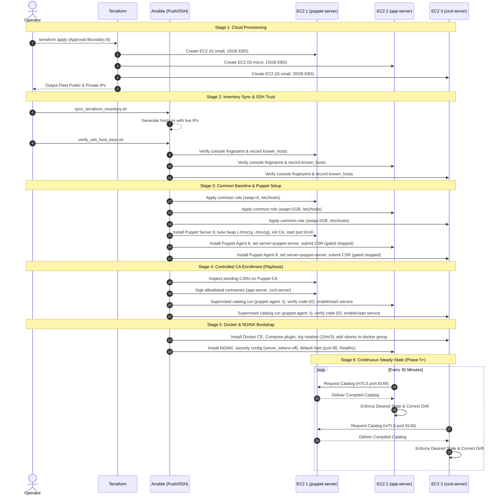

# Architectural Specification: Complementary Roles of Ansible and Puppet
## Infrastructure Bootstrap, Orchestration, and Continuous Desired-State Management

---

## 1. Executive Summary & Architectural Premise

The **AI-Powered Git Repository Analyzer** DevOps platform implements an intentional, multi-tier infrastructure automation architecture across three dedicated Amazon EC2 Ubuntu 24.04 LTS instances:

1. **EC2 1 (`puppet-server`)**: Centralized Configuration Management & Certificate Authority.
2. **EC2 2 (`app-server`)**: Public Application Host (NGINX, React production build, Node.js/Express API, Nagios Core).
3. **EC2 3 (`cicd-server`)**: CI/CD Execution & Repository Analysis (Jenkins controller, Docker Engine, ephemeral analyzer containers, NRPE daemon).

A foundational design decision in this project is the **deliberate integration of both Ansible and Puppet**, rather than relying exclusively on either tool alone. 

While naive infrastructure designs often treat Ansible and Puppet as competing or interchangeable configuration management tools, this project leverages them as **complementary automation layers** operating at distinct stages of the infrastructure lifecycle:
- **Ansible is the Orchestration and Bootstrap Layer**: Operating over an agentless, push-based SSH transport, Ansible provisions prerequisites, injects private networking, establishes swap partitions, bootstraps the Puppet Server and Agents, coordinates mutual TLS CA enrollment, and establishes the container engine and baseline web server.
- **Puppet is the Continuous Configuration Management Layer**: Operating over an agent-server, pull-based mTLS transport, Puppet continuously enforces declarative desired-state catalogs, corrects out-of-band configuration drift, manages runtime services, and ensures node configuration consistency over a native 30-minute convergence loop.

This specification documents the technical rationale, operational boundaries, lifecycle interaction, and engineering significance of this dual-tool architecture.

---

## 2. The Role of Ansible: Infrastructure Orchestration & Bootstrap

### 2.1 Core Purpose
Ansible serves as the **initial orchestration engine**. Its operational mission is to transition bare, freshly provisioned EC2 virtual machines into an initial, usable, secure, and correctly configured baseline where advanced daemon-based management (Puppet, Docker, NGINX) can function reliably.

### 2.2 Implemented Responsibilities in Phase 4 (Checkpoints 4.1–4.8)
Every capability documented below represents verified code currently implemented in [`ansible/roles/`](file:///home/aditya-2274/Git-repo-analyzer/ansible/roles/) and [`ansible/playbooks/`](file:///home/aditya-2274/Git-repo-analyzer/ansible/playbooks/):

1. **Deterministic SSH Transport & Cryptographic Trust (Checkpoint 4.1)**:
   - Dynamic synchronization of public/private fleet IPs from Terraform state via [`sync_terraform_inventory.sh`](file:///home/aditya-2274/Git-repo-analyzer/ansible/scripts/sync_terraform_inventory.sh).
   - Pre-flight SSH host-key verification against EC2 console fingerprints via [`verify_ssh_host_keys.sh`](file:///home/aditya-2274/Git-repo-analyzer/ansible/scripts/verify_ssh_host_keys.sh), preventing Man-In-The-Middle (MITM) attacks and eliminating blind Trust-On-First-Use (TOFU).
2. **Fleet Inventory Management & Host Partitioning**:
   - Maintenance of the canonical inventory in [`ansible/inventory/hosts.ini`](file:///home/aditya-2274/Git-repo-analyzer/ansible/inventory/hosts.ini) defining exact fleet groups (`[puppet_server]`, `[application]`, `[cicd]`, and `[puppet_agents:children]`).
3. **Common Host Preparation & OS Hardening (Checkpoint 4.2)**:
   - Safe, non-destructive APT lock contention handling using Python `fcntl.lockf` record-lock inspection without killing system processes.
   - Dynamic `/etc/hosts` private IP resolution derived from inventory hostvars, ensuring reliable inter-node DNS before Puppet is operational.
   - Per-instance swapfile allocation across 9 safety scenarios (1 GB on EC2 2, 2 GB on EC2 3, zero swap on EC2 1 to protect JVM stability).
4. **Puppet Server & CA Bootstrap (Checkpoint 4.3)**:
   - Automated installation of official PuppetLabs Puppet Server 8 on EC2 1 using APT pinning (`origin apt.puppet.com` @ Priority 900) over Ubuntu Universe.
   - JVM heap memory tuning down to `-Xms1g -Xmx1g` in `/etc/default/puppetserver` and JRuby instance restriction (`max-active-jrubies: 1`) to fit within `t3.small` resource boundaries.
   - Safe 3-state CA initialization before service startup, guaranteeing zero overwrite of existing valid cryptographic keys.
5. **Puppet Agent Bootstrap & Service Gating (Checkpoint 4.4)**:
   - Installation of official `puppet-agent` (8.10.x) on EC2 2 and EC2 3.
   - Stable identity configuration (`app-server` and `cicd-server`) and `server = puppet-server` declaration in `puppet.conf`.
   - **Gated service lifecycle invariant**: Enforces `puppet_agent_service_state: "stopped"` and `puppet_agent_service_enabled: false` during bootstrap, preventing premature autonomous background CA polling or unsupervised catalog execution.
6. **Controlled Multi-Node CA Enrollment & Supervised Handover (Checkpoint 4.5)**:
   - Orchestration of a 9-step cross-instance workflow across 3 separate plays in [`enroll-puppet-agents.yml`](file:///home/aditya-2274/Git-repo-analyzer/ansible/playbooks/enroll-puppet-agents.yml).
   - Strict CSR allowlisting rejecting unknown certnames, individual CSR signing via `puppetserver ca sign`, and supervised first-run catalog application (`puppet agent -t --detailed-exitcodes`).
   - Activation of agent systemd daemons gated strictly upon catalog exit code 0 or 2.
7. **Docker Engine & Compose Plugin Bootstrap (Checkpoint 4.6)**:
   - Automated installation of official Docker CE and Compose plugin exclusively on EC2 3 (`cicd-server`).
   - Deployment of `/etc/docker/daemon.json` enforcing bounded JSON-file log rotation (`max-size: 10m`, `max-file: 3`) to protect the 20 GB root EBS volume.
   - Strict security assertions rejecting unauthenticated TCP daemon exposure (`tcp://`) and preventing premature addition of the uninstalled `jenkins` user to the root-equivalent `docker` group.
8. **NGINX Baseline Web Server Bootstrap (Checkpoint 4.7)**:
   - Installation of official distribution NGINX package exclusively on EC2 2 (`app-server`).
   - Baseline security configuration disabling server version disclosure (`server_tokens off;`) and directory indexing (`autoindex off;`).
   - Deployment of a default virtual host on port 80 serving `/healthz` returning HTTP 200, with configuration syntax pre-validation via `nginx -t` before notifying handlers.
9. **Master Fleet Orchestration (Checkpoint 4.8)**:
   - Unification of the fleet deployment sequence in [`ansible/playbooks/site.yml`](file:///home/aditya-2274/Git-repo-analyzer/ansible/playbooks/site.yml), coordinating execution order across `hosts: all`, `hosts: puppet_server`, `hosts: puppet_agents`, `hosts: cicd`, and `hosts: application`.

### 2.3 Scope Boundary: What Ansible Does NOT Own
Ansible is **not** the desired-state owner for the long-running application lifecycle. Ansible does not manage ongoing Node.js runtime environments, application systemd units, production reverse-proxy virtual hosts, or Nagios monitoring checks. Once an EC2 instance is enrolled in Puppet, Ansible will never execute plays that overwrite resources owned by Puppet.

---

## 3. The Role of Puppet: Continuous Desired-State Management & Drift Correction

### 3.1 Core Purpose
Puppet serves as the **centralized desired-state configuration management engine**. Its operational mission is to guarantee that once servers are provisioned and bootstrapped, their internal configurations strictly match the authoritative compiled catalog, continuously self-healing against unauthorized out-of-band modifications.

### 3.2 Implemented Capabilities vs. Planned Phase 5 Work

| Subsystem / Capability | Checkpoint 4.3–4.5 Status (Implemented) | Phase 5 Status (Planned Architecture) |
| :--- | :--- | :--- |
| **Puppet Server & CA** | Operational on EC2 1; JVM tuned; CA initialized; port 8140 active. | Continues compiling catalogs; distributes production code environments. |
| **Puppet Agent** | Installed on EC2 2 & 3; enrolled with signed certificates; daemon started. | Runs continuously with `runinterval = 30m` polling EC2 1 for catalogs. |
| **Authentication & Trust** | mTLS established; certnames `app-server` and `cicd-server` verified. | All catalog compilation and report submissions secured by mTLS. |
| **Base Configuration Drift**| Validated via initial supervised run (`puppet agent -t`). | Enforces `/etc/hosts`, baseline packages, and user accounts. |
| **Node.js 20 LTS Runtime** | *Not implemented in Phase 4.* | **Exclusively Owned by Puppet** on EC2 2 (Phase 5B). |
| **Application Systemd Unit**| *Not implemented in Phase 4.* | **Exclusively Owned by Puppet** (`git-repo-analyzer-backend.service`). |
| **Production NGINX VHost** | *Baseline port 80 default only (Ansible).* | **Exclusively Owned by Puppet** (React static build + `/api/` reverse proxy). |
| **Monitoring Daemons** | *Not implemented in Phase 4.* | **Exclusively Owned by Puppet** (Nagios Core on EC2 2, NRPE on EC2 1 & 3). |

### 3.3 The Puppet Operational Paradigm (Pull-Based Convergence)
Puppet operates on a declarative graph-based compilation model:
1. **Fact Gathering**: The Puppet Agent on EC2 2 or EC2 3 gathers system facts via Facter (OS version, IP addresses, memory, kernel) and transmits them securely over TLS port 8140 to the Puppet Server.
2. **Catalog Compilation**: The Puppet Server compiles node-specific manifests (`site.pp` and modules) into a deterministic dependency graph called a **catalog**.
3. **Local Application**: The agent receives the catalog, compares the declared desired state against the live system state, and applies only the changes necessary to achieve convergence.
4. **Drift Remediation**: If an operator manually modifies a configuration file on EC2 2 (e.g., changes an NGINX proxy pass or stops a backend service), Puppet automatically detects the state difference during its next 30-minute run and restores the declared file contents and service state without human intervention.
5. **Compliance Reporting**: The agent submits an execution report back to the Puppet Server documenting whether the node was in sync (`unchanged`), corrected (`changed`), or encountered failures (`failed`).

---

## 4. Architectural Analysis: Why Both Tools?

To understand why the combined architecture is technically superior for this platform, we evaluate three architectural alternatives:

### Approach A: Only Ansible (Agentless Push Model)

```text
[ Terraform ] ──► [ EC2 1, 2, 3 ] ◄──SSH── [ Operator / Ansible Controller ]
```

#### What Ansible Alone Could Accomplish
Ansible could theoretically execute the entire project lifecycle:
- Provision base OS packages and swap partitions.
- Deploy Docker, Jenkins, Node.js, and NGINX.
- Deploy the React frontend and Express backend.
- Maintain configuration by periodically re-running playbooks.

#### Limitations of Using Only Ansible for This Platform
1. **Execution Model Disconnect**: Ansible is an **event-driven, push-based tool**. It executes when an operator, CI/CD pipeline, or cron job explicitly executes `ansible-playbook`. It does not possess a native autonomous daemon model on managed nodes.
2. **Configuration Drift Vulnerability**: If a developer, sysadmin, or out-of-band process modifies `/etc/nginx/sites-available/default` or terminates the backend service, Ansible is completely unaware of the drift until the next playbook execution.
3. **Scalability of Scheduling**: To approximate continuous enforcement with Ansible, the team would need to deploy AWX/Tower or configure distributed crontabs running `ansible-pull`. This introduces secondary architectural complexity that recreates an agent-based system without Puppet's native declarative dependency graph.
4. **Loss of Separation of Concerns**: Blending initial OS bootstrap with ongoing runtime state in a single tool muddies operational boundaries, making it difficult to distinguish between "bootstrapping a fresh server" and "enforcing steady-state compliance."

---

### Approach B: Only Puppet (Agent-Server Pull Model)

```text
[ Puppet Server (EC2 1) ] ◄──mTLS 8140── [ Puppet Agents (EC2 2, 3) ]
```

#### What Puppet Alone Could Accomplish
Puppet excels at steady-state configuration:
- Declaratively managing packages, configuration files, and systemd units.
- Enforcing compliance across thousands of nodes.
- Continuously correcting configuration drift every 30 minutes.

#### Limitations of Using Only Puppet for This Platform
1. **The "Chicken-and-Egg" Bootstrap Dilemma**: Puppet cannot manage a server until the Puppet Agent is installed, configured, authenticated, and enrolled. Furthermore, the Puppet Server itself must be installed, tuned, and initialized with a Certificate Authority before any agent can connect. Puppet cannot install itself on bare EC2 instances without an external orchestration mechanism.
2. **User-Data Script Limitations**: Relying on monolithic AWS EC2 `user_data` shell scripts to install Puppet Server and Agents is brittle, difficult to debug, lacks idempotency guarantees, and fails to provide structured error handling across multi-node dependencies.
3. **Multi-Node Orchestration Friction**: The Puppet CA enrollment sequence requires coordinated cross-node actions: Agent A generates CSR $\to$ Puppet Server inspects and signs CSR $\to$ Agent A downloads certificate $\to$ Agent A runs catalog. Orchestrating this multi-instance sequence across private networks is unnatural and complex in pure Puppet, but trivial in an Ansible playbook with multiple plays (`hosts: puppet_server`, `hosts: puppet_agents`).
4. **Lack of Ad-Hoc Orchestration**: Task-based, ordered workflows (such as zero-downtime rolling deployments, database schema migrations, or dynamic SSH host-key verification) require an orchestration tool rather than a state-convergence tool.

---

### Approach C: Ansible + Puppet (The Selected Architecture)

By combining Ansible and Puppet, the platform achieves a separation of concerns that leverages the unique architectural strengths of both paradigms:

```text
┌────────────────────────────────────────────────────────────────────────────────────────┐
│                                 INFRASTRUCTURE LIFECYCLE                               │
│                                                                                        │
│   Phase 1-3: Provisioning     Phase 4: Bootstrap & Handover     Phase 5+: Steady-State │
│                                                                                        │
│     ┌──────────────┐             ┌─────────────────────┐          ┌────────────────┐   │
│     │  Terraform   │ ──────────► │  Ansible (Push/SSH) │ ───────► │ Puppet (Pull)  │   │
│     └──────────────┘             └─────────────────────┘          └────────────────┘   │
│       • VPC & Subnets              • Dynamic Inventory Sync         • Runtime Config   │
│       • 3 EC2 Instances            • Host-Key Cryptographic Trust   • Drift Healing    │
│       • Security Groups            • APT Locks, Swap, /etc/hosts    • App VHosts       │
│       • EBS Volumes                • Install Puppet Server & Agent  • 30m Convergence  │
│                                    • Orchestrate CA Enrollment                         │
│                                    • Bootstrap Docker & NGINX                          │
└────────────────────────────────────────────────────────────────────────────────────────┘
```

#### Detailed Capability Matrix

| Operational Capability | Ansible (Push / Orchestrator) | Puppet (Pull / Desired-State) | Platform Assignment | Rationale |
| :--- | :---: | :---: | :---: | :--- |
| **Initial Cloud Bootstrapping** | **Optimal** | Unsuitable | **Ansible** | Connects to vanilla OS over SSH; zero pre-installed agent requirements. |
| **Cross-Node Task Ordering** | **Optimal** | Complex | **Ansible** | Orchestrates dependent multi-play workflows across different fleet hosts. |
| **PKI & CA Trust Workflow** | **Orchestrator** | **CA Authority** | **Combined** | Puppet Server provides CA; Ansible coordinates CSR submission and signing. |
| **Dynamic Host-Key Verification**| **Optimal** | Unsuitable | **Ansible** | Probes EC2 console fingerprints before establishing trust. |
| **Continuous Drift Correction** | Requires Polling | **Native (30m)** | **Puppet** | Autonomous daemon convergence without external trigger mechanisms. |
| **Declarative Dependency Graph** | Linear Tasks | **Native Graph** | **Puppet** | Evaluates resource dependencies (`before`, `require`, `notify`) globally. |
| **Runtime Service Management** | Procedural | **Declarative** | **Puppet** | Enforces running state and auto-restarts failed services upon drift. |
| **Ad-Hoc / Application Deploys** | **Optimal** | Rigid | **Ansible** | Triggers build executions, smoke tests, and deployments on demand. |

---

## 5. End-to-End Infrastructure Lifecycle

The complete lifecycle across all three EC2 instances progresses through ten distinct architectural stages:

```mermaid
flowchart TD
    subgraph Provisioning ["Stage 1: Provisioning (Terraform)"]
        TF["Terraform Apply"] -->|"Provisions VPC, SGs, EBS"| EC2_1["EC2 1: puppet-server<br/>(10.0.0.10)"]
        TF --> EC2_2["EC2 2: app-server<br/>(10.0.0.11)"]
        TF --> EC2_3["EC2 3: cicd-server<br/>(10.0.0.12)"]
    end

    subgraph Bootstrap ["Stage 2: Orchestration & Bootstrap (Ansible)"]
        ANS["Ansible Controller<br/>(Push via SSH / Port 22)"]
        ANS -.->|"1. Dynamic Inventory Sync"| TF
        ANS -->|"2. Cryptographic Host-Key Trust"| EC2_1
        ANS -->|"2. Cryptographic Host-Key Trust"| EC2_2
        ANS -->|"2. Cryptographic Host-Key Trust"| EC2_3
        ANS -->|"3. Common Role: APT locks, swap, /etc/hosts"| EC2_1 & EC2_2 & EC2_3
        ANS -->|"4. Install Puppet Server 8 & Tune JVM"| EC2_1
        ANS -->|"5. Install Puppet Agent 8 (Gated/Stopped)"| EC2_2 & EC2_3
        ANS -->|"6. Coordinate 9-Step CA Enrollment"| EC2_1 & EC2_2 & EC2_3
        ANS -->|"7. Install Docker CE & Compose"| EC2_3
        ANS -->|"8. Install NGINX Baseline"| EC2_2
    end

    subgraph Enforcement ["Stage 3: Desired-State Management (Puppet)"]
        PS["Puppet Server 8<br/>(CA & Compiler / Port 8140)"]
        PA2["Puppet Agent<br/>(EC2 2)"] -->|"9. mTLS Catalog Request"| PS
        PA3["Puppet Agent<br/>(EC2 3)"] -->|"9. mTLS Catalog Request"| PS
        PS -->|"Compiles Catalog"| PA2 & PA3
        PA2 -->|"10. 30m Drift Enforcement:<br/>Node.js, App Service, VHost"| EC2_2
        PA3 -->|"10. 30m Drift Enforcement:<br/>NRPE, Jenkins baseline"| EC2_3
    end
```



### Detailed Sequence of Handover and Execution



---

## 6. Engineering Significance in a Production DevOps Context

Adopting this dual-tool architecture demonstrates several advanced systems engineering principles:

### 1. Separation of Operational Lifecycles
By separating **imperative bootstrapping** from **declarative convergence**, the infrastructure code avoids the common antipattern of "mega-playbooks" that attempt to manage every layer from bare kernel parameters to application code updates. 

### 2. Elimination of Configuration Drift
In enterprise environments, configuration drift accounts for a significant percentage of production outages. A manual hotfix applied to an NGINX configuration file or a developer inadvertently disabling a systemd service can go unnoticed for weeks with an agentless push tool. Puppet's 30-minute convergence loop guarantees that uncommitted manual hotfixes are automatically reverted, enforcing **Infrastructure as Code (IaC) as the single source of truth**.

### 3. Ephemeral Fleet Reproducibility
In accordance with **ADR 011 (Strict On-Demand Ephemeral Lifecycle)**, the entire three-node fleet is provisioned for demonstrations and destroyed immediately afterward to maintain cost governance (~$0.0773/hour running cost). 
Because Ansible fully automates the complex Puppet CA enrollment and JVM tuning sequence, the entire multi-node environment can be reconstructed from scratch in under 12 minutes with zero manual intervention.

### 4. Defense-in-Depth Security Architecture
The integration enforces least-privilege security boundaries:
- Ansible accesses instances strictly over SSH (TCP 22) restricted to the operator's `/32` public IP.
- Puppet communicates strictly over private VPC networking via mutual TLS (TCP 8140), with strict allowlist-based certificate signing that prevents rogue nodes from acquiring configuration catalogs.
- Management ports are never exposed to the public internet.

---

## 7. Governing Resource Ownership & Handover Matrix

To eliminate any potential for configuration flapping or resource conflicts between Ansible and Puppet, the platform enforces the strict resource ownership boundaries established in **ADR 006**:

| Resource / Subsystem | Bootstrap Owner (Ansible) | Steady-State Owner (Puppet) | Handover & Operational Policy |
| :--- | :--- | :--- | :--- |
| **Base OS Packages** | Installs initial packages | Maintains package baseline | Ansible bootstraps once; Puppet manages ongoing package definitions. |
| **Swapfile (`/swapfile`)** | Configures & activates | - | Ansible configures `/swapfile` (1 GB EC2 2, 2 GB EC2 3, 0 MB EC2 1); Puppet does not manage swap. |
| **Private DNS (`/etc/hosts`)** | Injects dynamic IPs | Enforces consistency | Ansible derives IPs from Terraform inventory; Puppet enforces consistency against drift. |
| **Docker Engine & Plugins** | Installs Docker CE & Compose| - | Ansible manages Docker installation and user membership; Puppet does not manage Docker. |
| **Puppet Server & CA** | Installs & tunes JVM | - | Ansible manages JVM heap (`-Xms1g -Xmx1g`), JRuby limits, and CA state; Puppet does not manage its own server package. |
| **Puppet Agent & PKI** | Installs & submits CSR | - | Ansible oversees controlled CSR signing; hands over to agent daemon once enrolled. |
| **NGINX Baseline Package** | Installs baseline package | - | Ansible installs `nginx` package; Puppet manages virtual hosts and proxies. |
| **NGINX Virtual Hosts** | Deploys default port 80 | **Exclusively Owns** | Ansible ensures premature app routes are absent; Puppet deploys production React vhost and `/api/` proxy. |
| **Node.js 20 LTS Runtime** | - | **Exclusively Owns** | Puppet installs and manages Node.js runtime on EC2 2 (Phase 5B). |
| **Backend Systemd Unit** | - | **Exclusively Owns** | Puppet deploys and manages `git-repo-analyzer-backend.service` (Phase 5B). |
| **Backend Environment File**| - | **Exclusively Owns** | Puppet deploys `/etc/git-repo-analyzer/backend.env` (mode `0640`, `root:gitrepo`) (Phase 5B). |
| **Nagios Core & Plugins** | - | **Exclusively Owns** | Puppet compiles, configures, and manages Nagios Core on EC2 2 (Phase 5A). |
| **NRPE Daemon & Checks** | - | **Exclusively Owns** | Puppet manages `nrpe.cfg` and monitoring check scripts on EC2 1 & EC2 3 (Phase 5A). |

> [!IMPORTANT]
> **The Strict Handover Policy**: Once an EC2 instance completes Checkpoint 4.5 enrollment, Ansible will never execute plays that manage or overwrite NGINX virtual hosts, application systemd units, environment files, or Nagios/NRPE configurations. All ongoing configuration drift management belongs exclusively to Puppet.
