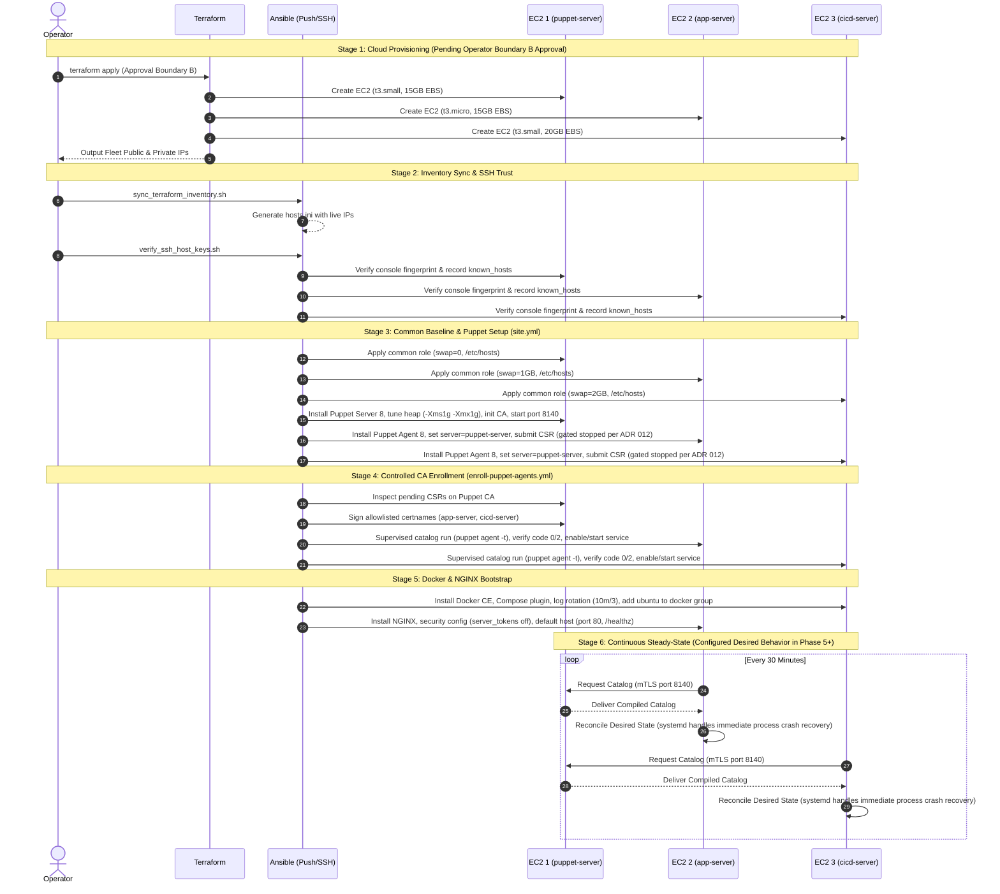

# Architectural Specification: Complementary Roles of Ansible and Puppet
## Infrastructure Bootstrap, Orchestration, and Continuous Desired-State Management

---

## 1. Executive Summary & Architectural Premise

The **AI-Powered Git Repository Analyzer** DevOps platform implements an intentional, multi-tier infrastructure automation architecture across three dedicated Amazon EC2 Ubuntu 24.04 LTS instances:

1. **EC2 1 (`puppet-server`)**: Centralized Configuration Management & Certificate Authority.
2. **EC2 2 (`app-server`)**: Public Application Host (NGINX, React production build, Node.js/Express API, Nagios Core).
3. **EC2 3 (`cicd-server`)**: CI/CD Execution & Repository Analysis (Jenkins controller, Docker Engine, ephemeral analyzer containers, NRPE daemon).

A foundational design decision in this project is the **deliberate integration of both Ansible and Puppet**, rather than relying exclusively on either tool alone. 

While naive infrastructure designs often treat Ansible and Puppet as competing or interchangeable configuration management tools, this project leverages them as **complementary automation layers** operating at distinct stages of the infrastructure lifecycle:
- **Ansible is the Orchestration and Bootstrap Layer**: Operating over an agentless, push-based SSH transport, the implemented Ansible automation is designed to provision prerequisites, inject private networking, establish swap partitions, bootstrap the Puppet Server and Agents, coordinate mutual TLS CA enrollment, and establish the container engine and baseline web server upon initial deployment.
- **Puppet is the Continuous Configuration Management Layer**: Operating over an agent-server, pull-based mTLS transport, Puppet is architected to continuously enforce declarative desired-state catalogs, correct out-of-band configuration drift, manage runtime services, and ensure node configuration consistency over a configured 30-minute convergence loop once live infrastructure is deployed in Phase 5.

This specification documents the technical rationale, operational boundaries, lifecycle interaction, and engineering significance of this dual-tool architecture.

---

## 2. The Role of Ansible: Infrastructure Orchestration & Bootstrap

### 2.1 Core Purpose
In this platform architecture, Ansible serves as the **initial orchestration engine**. Its operational mission is to transition bare, freshly provisioned EC2 virtual machines into an initial, usable, secure, and correctly configured baseline where advanced daemon-based management (Puppet, Docker, NGINX) can function reliably.

### 2.2 Implemented Responsibilities in Phase 4 (Checkpoints 4.1–4.8)
Every capability documented below represents verified automation code currently implemented and locally fixture-tested under Approval Boundary A in [`ansible/roles/`](file:///home/aditya-2274/Git-repo-analyzer/ansible/roles/) and [`ansible/playbooks/`](file:///home/aditya-2274/Git-repo-analyzer/ansible/playbooks/); live execution on cloud instances remains strictly pending Approval Boundary B provisioning:

1. **Deterministic SSH Transport & Cryptographic Trust (Checkpoint 4.1)**:
   - Dynamic synchronization of public/private fleet IPs from Terraform state via [`sync_terraform_inventory.sh`](file:///home/aditya-2274/Git-repo-analyzer/ansible/scripts/sync_terraform_inventory.sh).
   - Pre-flight SSH host-key verification against EC2 console fingerprints via [`verify_ssh_host_keys.sh`](file:///home/aditya-2274/Git-repo-analyzer/ansible/scripts/verify_ssh_host_keys.sh), preventing Man-In-The-Middle (MITM) attacks and eliminating blind Trust-On-First-Use (TOFU).
2. **Fleet Inventory Management & Host Partitioning**:
   - Maintenance of the canonical inventory in [`ansible/inventory/hosts.ini`](file:///home/aditya-2274/Git-repo-analyzer/ansible/inventory/hosts.ini) defining exact fleet groups (`[puppet_server]`, `[application]`, `[cicd]`, and `[puppet_agents:children]`).
3. **Common Host Preparation & OS Hardening (Checkpoint 4.2)**:
   - Safe, non-destructive APT lock contention handling using Python `fcntl.lockf` record-lock inspection without killing system processes.
   - Dynamic `/etc/hosts` private IP resolution derived from inventory hostvars, ensuring reliable inter-node DNS before Puppet is operational.
   - Per-instance swapfile allocation across 9 safety scenarios (1 GB on EC2 2, 2 GB on EC2 3, zero swap on EC2 1 to protect JVM stability).
4. **Puppet Server & CA Bootstrap (Checkpoint 4.3)**:
   - Automated installation of official PuppetLabs Puppet Server 8 on EC2 1 using APT pinning (`origin apt.puppet.com` @ Priority 900) over Ubuntu Universe.
   - JVM heap memory tuning down to `-Xms1g -Xmx1g` in `/etc/default/puppetserver` and JRuby instance restriction (`max-active-jrubies: 1`) to fit within `t3.small` resource boundaries.
   - Safe 3-state CA initialization before service startup, guaranteeing zero overwrite of existing valid cryptographic keys.
5. **Puppet Agent Bootstrap & Service Gating (Checkpoint 4.4)**:
   - Installation of official `puppet-agent` (8.10.x) on EC2 2 and EC2 3.
   - Stable identity configuration (`app-server` and `cicd-server`) and `server = puppet-server` declaration in `puppet.conf`.
   - **Gated service lifecycle invariant**: Enforces `puppet_agent_service_state: "stopped"` and `puppet_agent_service_enabled: false` during bootstrap, preventing premature autonomous background CA polling or unsupervised catalog execution (ADR 012).
6. **Controlled Multi-Node CA Enrollment & Supervised Handover (Checkpoint 4.5)**:
   - Orchestration of a 9-step cross-instance workflow across 3 separate plays in [`enroll-puppet-agents.yml`](file:///home/aditya-2274/Git-repo-analyzer/ansible/playbooks/enroll-puppet-agents.yml).
   - Strict CSR allowlisting rejecting unknown certnames, individual CSR signing via `puppetserver ca sign`, and supervised first-run catalog application (`puppet agent -t --detailed-exitcodes`).
   - Activation of agent systemd daemons gated strictly upon catalog exit code 0 or 2.
7. **Docker Engine & Compose Plugin Bootstrap (Checkpoint 4.6)**:
   - Automated installation of official Docker CE and Compose plugin exclusively on EC2 3 (`cicd-server`).
   - Deployment of `/etc/docker/daemon.json` enforcing bounded JSON-file log rotation (`max-size: 10m`, `max-file: 3`) to protect the 20 GB root EBS volume.
   - Strict security assertions rejecting unauthenticated TCP daemon exposure (`tcp://`) and preventing premature addition of the uninstalled `jenkins` user to the root-equivalent `docker` group.
8. **NGINX Baseline Web Server Bootstrap (Checkpoint 4.7)**:
   - Installation of official distribution NGINX package exclusively on EC2 2 (`app-server`).
   - Baseline security configuration disabling server version disclosure (`server_tokens off;`) and directory indexing (`autoindex off;`).
   - Deployment of a default virtual host on port 80 serving `/healthz` returning HTTP 200, with configuration syntax pre-validation via `nginx -t` before notifying handlers.
9. **Master Fleet Orchestration (Checkpoint 4.8)**:
   - Unification of the fleet deployment sequence in [`ansible/playbooks/site.yml`](file:///home/aditya-2274/Git-repo-analyzer/ansible/playbooks/site.yml), coordinating execution order across `hosts: all`, `hosts: puppet_server`, `hosts: puppet_agents`, `hosts: cicd`, and `hosts: application`.

### 2.3 Scope Boundary: What Ansible Does NOT Own
Ansible is **not** the desired-state owner for the long-running application lifecycle. Ansible does not manage ongoing Node.js runtime environments, application systemd units, production reverse-proxy virtual hosts, or Nagios monitoring checks. Once an EC2 instance is enrolled in Puppet, Ansible will never execute plays that overwrite resources owned by Puppet.

#### Operational Distinction: Deployment Orchestration vs. Persistent Configuration Ownership
A critical architectural distinction governs the boundaries between **deployment orchestration** and **persistent configuration ownership**:
- **Application Build Execution**: Executed by Jenkins CI/CD on EC2 3 (or GitHub Actions in CI), compiling the React production bundle, running unit tests, and packaging Docker container images.
- **Deployment Orchestration**: Ansible (or an automated deployment pipeline) orchestrates the operational release workflow—staging application build artifacts, initiating application reload commands, or executing pre/post-deployment health verification checks.
- **Persistent Configuration Ownership**: Exclusively owned and maintained by Puppet. Puppet manages the Node.js runtime packages, the systemd unit file (`git-repo-analyzer-backend.service`), system user/group definitions (`gitrepo:gitrepo`), filesystem ownership and permissions, environment configuration files (`/etc/git-repo-analyzer/backend.env`), and NGINX reverse-proxy configurations.
- **Service Configuration & Desired-State Enforcement**: Puppet continuously enforces that service unit files, configuration templates, and daemon operating parameters match the authoritative compiled catalog.
- **Strict Boundary Rule**: An application deployment workflow may deploy or update application release artifacts within designated release directories, but it must **never** modify, template, or overwrite systemd unit files, environment configuration files, or virtual host definitions exclusively managed by Puppet.

---

## 3. The Role of Puppet: Continuous Desired-State Management & Drift Correction

### 3.1 Core Purpose
Puppet serves as the **centralized desired-state configuration management engine**. Its operational mission is to guarantee that once servers are provisioned and bootstrapped, their internal configurations strictly match the authoritative compiled catalog, continuously reconciling unauthorized out-of-band modifications during scheduled catalog runs.

### 3.2 Implemented Capabilities vs. Planned Phase 5 Work

| Subsystem / Capability | Phase 4 Implementation Status (Boundary A) | Phase 5 Planned Steady-State Ownership |
| :--- | :--- | :--- |
| **Puppet Server & CA** | Automation implemented and fixture-tested (Checkpoint 4.3); live package installation, JVM tuning, and CA setup pending Boundary B provisioning on EC2 1. | Compiles catalogs; distributes production code environments; manages CA certificate renewals. |
| **Puppet Agent** | Automation implemented and fixture-tested (Checkpoints 4.4 & 4.5); live package installation, initial CSR submission, and enrollment pending Boundary B provisioning on EC2 2 & 3. | Configured desired behavior: runs continuously with `runinterval = 30m` polling EC2 1 for catalogs. |
| **Authentication & Trust** | Mutual TLS enrollment workflow implemented in code (Checkpoint 4.5); live certificate exchange and mTLS validation pending Boundary B. | All catalog compilation and report submissions secured by mTLS over TCP 8140. |
| **Base Configuration Drift**| Initial supervised run automation verified in code (`puppet agent -t`); live continuous drift enforcement active once Phase 5 catalogs are compiled. | Enforces `/etc/hosts`, baseline packages, and user accounts. |
| **Node.js 24 LTS Runtime** | *Not implemented in Phase 4.* | **Exclusively Owned by Puppet** (`application::nodejs` provisionally implemented & audited locally under Boundary A; pending review & Boundary B). |
| **Application Systemd Unit**| *Not implemented in Phase 4.* | **Exclusively Owned by Puppet** (`application::backend` / `git-repo-analyzer-backend.service` provisionally implemented & audited locally under Boundary A; pending review & Boundary B). |
| **Production NGINX VHost** | *Baseline port 80 default only (Ansible Checkpoint 4.7).* | **Exclusively Owned by Puppet** (`application::nginx` React static build + `/api/` reverse proxy provisionally implemented & audited locally under Boundary A; pending review & Boundary B). |
| **Monitoring Daemons** | *Implemented & Locally Validated in Phase 5A (Boundary A).* | **Exclusively Owned by Puppet** (Nagios Core + Apache loopback on EC2 2; NRPE server on EC2 1 & 3, client plugin on EC2 2; live convergence pending Boundary B). |

### 3.3 The Puppet Operational Paradigm (Pull-Based Convergence)
Puppet operates on a declarative graph-based compilation model during periodic or triggered catalog runs (configured with `runinterval = 30m` once agents are activated):
1. **Fact Gathering**: The Puppet Agent on EC2 2 or EC2 3 gathers system facts via Facter (OS version, IP addresses, memory, kernel) and transmits them securely over TLS port 8140 to the Puppet Server.
2. **Catalog Compilation**: The Puppet Server compiles node-specific manifests (`site.pp` and modules) into a deterministic dependency graph called a **catalog**.
3. **Local Application**: The agent receives the catalog, compares the declared desired state against the live system state, and applies only the changes necessary to achieve convergence.
4. **Drift Remediation During Catalog Runs**: If an operator modifies a configuration file on EC2 2 (e.g., changes an NGINX proxy directive) or disables a systemd service out-of-band, Puppet detects the state difference during its next scheduled catalog run (every 30 minutes, or upon manual execution) and restores the declared file contents and service state to match the catalog.
5. **Compliance Reporting**: The agent submits an execution report back to the Puppet Server documenting whether the node was in sync (`unchanged`), corrected (`changed`), or encountered failures (`failed`).

#### Operational Distinction: Process Supervision vs. Desired-State Enforcement vs. Monitoring
Puppet is **not** an immediate process supervisor or a real-time monitoring system. Systems engineering responsibilities are strictly separated across three distinct operational tiers:
- **Process Supervision (`systemd`)**: Operates continuously at the local kernel/OS level. For running daemons (such as NGINX in Phase 4), `systemd` supervises process lifecycles directly. In the planned Phase 5B application deployment, the backend systemd service unit (`git-repo-analyzer-backend.service`) is architected with `Restart=always` and `RestartSec=5s` so that if the Node.js backend process terminates unexpectedly, `systemd` detects process death immediately and initiates an automated restart following the planned 5-second delay to prevent rapid crash-loop flapping. (This is planned Phase 5B configuration, not an existing verified service behavior in Phase 4).
- **Desired-State Enforcement (`Puppet`)**: Operates on a scheduled convergence cycle (every 30 minutes). During catalog execution, Puppet validates that the service is enabled, running, and configured with the correct unit file and environment parameters. If an administrator manually stopped or disabled the service out-of-band, Puppet reconciles the service to `ensure => running, enable => true` at the next catalog run.
- **Monitoring & Alerting (`Nagios Core` & `NRPE`)**: Operates on dedicated monitoring check intervals (every 1 to 5 minutes). Nagios actively probes endpoint health (HTTP `/healthz`, TCP ports, system resources). When a service fails or becomes unresponsive, Nagios detects the outage within minutes, records state transitions (SOFT/HARD), and alerts operators.

---

## 4. Architectural Analysis: Why Both Tools?

To understand why the combined architecture is technically superior for this platform, we evaluate three architectural alternatives:

### Approach A: Only Ansible (Agentless Push Model)

```text
[ Terraform ] ──► [ EC2 1, 2, 3 ] ◄──SSH── [ Operator / Ansible Controller ]
```

#### What Ansible Alone Could Accomplish
Ansible could execute the entire project lifecycle:
- Provision base OS packages and swap partitions.
- Deploy Docker, Jenkins, Node.js, and NGINX.
- Deploy the React frontend and Express backend.
- Enforce desired state through repeated playbook execution, scheduled automation (cron jobs), AWX / Ansible Automation Platform (AAP), or distributed `ansible-pull`.

#### Why Puppet Was Selected for Ongoing Configuration Management
While Ansible is fully capable of managing configuration drift when invoked periodically, Puppet was selected for ongoing desired-state management because:
1. **Native Agent Convergence Model**: Puppet's agent-based architecture provides an out-of-the-box, daemonized 30-minute convergence loop that runs natively on managed nodes without requiring the overhead of deploying and maintaining an external AWX/Tower cluster or managing distributed crontabs.
2. **Operational Separation of Concerns**: It establishes a clean division between procedural, multi-node bootstrap over SSH (Ansible) and continuous, steady-state catalog enforcement over mTLS (Puppet).
3. **Declarative State vs. Procedural Tasks**: Puppet catalogs compile into an explicit resource dependency graph evaluated locally by the agent, providing an authoritative desired-state specification separate from procedural deployment playbooks.

---

### Approach B: Only Puppet (Agent-Server Pull Model)

```text
[ Puppet Server (EC2 1) ] ◄──mTLS 8140── [ Puppet Agents (EC2 2, 3) ]
```

#### What Puppet Alone Could Accomplish
Puppet excels at steady-state configuration:
- Declaratively managing packages, configuration files, and systemd units.
- Enforcing compliance across nodes.
- Continuously correcting configuration drift during scheduled catalog runs.

#### Why Ansible Was Selected for the Initial Bootstrap Workflow
While Puppet can be bootstrapped on cloud instances using cloud-init, EC2 `user_data` shell scripts, pre-baked machine images (golden AMIs via Packer), or external provisioning tools, Ansible was explicitly selected for this project's initial workflow because:
1. **SSH-Based Fleet Access**: Connects directly to vanilla Ubuntu 24.04 LTS cloud instances immediately upon boot over standard SSH without requiring pre-baked custom AMIs.
2. **Dynamic Inventory Resolution**: Consumes Terraform output state directly via [`sync_terraform_inventory.sh`](file:///home/aditya-2274/Git-repo-analyzer/ansible/scripts/sync_terraform_inventory.sh), dynamically populating ephemeral public and private IPs into canonical groups.
3. **Deterministic Host-Key Verification**: Queries EC2 hypervisor console fingerprints via [`verify_ssh_host_keys.sh`](file:///home/aditya-2274/Git-repo-analyzer/ansible/scripts/verify_ssh_host_keys.sh) to establish cryptographic trust before session initiation, eliminating blind TOFU.
4. **Ordered Multi-Node Orchestration**: Coordinates cross-instance dependencies naturally (e.g., Puppet Server CA initialization on EC2 1 must be confirmed healthy before agents on EC2 2 and 3 submit CSRs).
5. **Automated Server and Agent Installation**: Modular Ansible roles handle vendor repository pinning, headless OpenJDK installation, JVM heap memory tuning, and systemd service gating.
6. **Controlled CSR Signing**: Automates the inspection, allowlisting, and individual signing of agent certificates without relying on insecure autosigning (`autosign = false`).
7. **Supervised Initial Catalog Execution**: Executes `puppet agent -t --detailed-exitcodes` under Ansible supervision, asserting clean exit codes (0 or 2) before enabling and starting the background agent daemon (ADR 012).

---

### Approach C: Ansible + Puppet (The Selected Architecture)

By combining Ansible and Puppet, the platform achieves an intentional separation of concerns that leverages the unique architectural strengths of both paradigms:

```text
┌────────────────────────────────────────────────────────────────────────────────────────┐
│                                 INFRASTRUCTURE LIFECYCLE                               │
│                                                                                        │
│   Phase 1-3: Provisioning     Phase 4: Bootstrap & Handover     Phase 5+: Steady-State │
│                                                                                        │
│     ┌──────────────┐             ┌─────────────────────┐          ┌────────────────┐   │
│     │  Terraform   │ ──────────► │  Ansible (Push/SSH) │ ───────► │ Puppet (Pull)  │   │
│     └──────────────┘             └─────────────────────┘          └────────────────┘   │
│       • VPC & Subnets              • Dynamic Inventory Sync         • Runtime Config   │
│       • 3 EC2 Instances            • Host-Key Cryptographic Trust   • Drift Healing    │
│       • Security Groups            • APT Locks, Swap, /etc/hosts    • App VHosts       │
│       • EBS Volumes                • Install Puppet Server & Agent  • 30m Convergence  │
│                                    • Orchestrate CA Enrollment                         │
│                                    • Bootstrap Docker & NGINX                          │
└────────────────────────────────────────────────────────────────────────────────────────┘
```

#### Detailed Capability Matrix

| Operational Capability | Ansible (Push / Orchestrator) | Puppet (Pull / Desired-State) | Platform Assignment | Engineering Rationale |
| :--- | :---: | :---: | :---: | :--- |
| **Initial Cloud Bootstrapping** | **Optimal** | Requires Pre-seeding | **Ansible** | Connects to vanilla OS over SSH; zero pre-installed agent requirements. |
| **Cross-Node Task Ordering** | **Optimal** | Complex | **Ansible** | Orchestrates dependent multi-play workflows across different fleet hosts. |
| **PKI & CA Trust Workflow** | **Orchestrator** | **CA Authority** | **Combined** | Puppet Server provides CA; Ansible coordinates CSR submission and individual signing. |
| **Dynamic Host-Key Verification**| **Optimal** | Unsuitable | **Ansible** | Probes EC2 console fingerprints before establishing trust. |
| **Continuous Drift Correction** | Requires Polling/AWX | **Native (30m)** | **Puppet** | Autonomous daemon convergence on managed nodes without external scheduling. |
| **Declarative Dependency Graph** | Linear Tasks | **Native Graph** | **Puppet** | Evaluates resource dependencies (`before`, `require`, `notify`) globally. |
| **Runtime Service Management** | Procedural | **Declarative** | **Puppet / systemd** | Puppet declaratively reconciles service state on catalog runs; systemd handles crash recovery. |
| **Deployment Orchestration** | **Optimal** | Rigid | **Ansible** | Coordinates application release workflows, artifact staging, and health probes. |
| **Persistent Configuration Ownership** | Drift-prone | **Authoritative** | **Puppet** | Exclusively owns systemd unit files, environment templates, and web server configs. |

---

## 5. End-to-End Infrastructure Lifecycle

The complete lifecycle across all three EC2 instances progresses through ten distinct architectural stages:

```mermaid
flowchart TD
    subgraph Provisioning ["Stage 1: Provisioning (Terraform)"]
        TF["Terraform Apply (Boundary B Approval)"] -->|"Provisions VPC, SGs, EBS"| EC2_1["EC2 1: puppet-server<br/>(10.0.0.10)"]
        TF --> EC2_2["EC2 2: app-server<br/>(10.0.0.11)"]
        TF --> EC2_3["EC2 3: cicd-server<br/>(10.0.0.12)"]
    end

    subgraph Bootstrap ["Stage 2: Orchestration & Bootstrap (Ansible: Implemented in Code, Execution Pending Boundary B)"]
        ANS["Ansible Controller<br/>(Push via SSH / Port 22)"]
        ANS -.->|"1. Dynamic Inventory Sync"| TF
        ANS -->|"2. Cryptographic Host-Key Trust"| EC2_1
        ANS -->|"2. Cryptographic Host-Key Trust"| EC2_2
        ANS -->|"2. Cryptographic Host-Key Trust"| EC2_3
        ANS -->|"3. Common Role: APT locks, swap, /etc/hosts"| EC2_1 & EC2_2 & EC2_3
        ANS -->|"4. Install Puppet Server 8 & Tune JVM"| EC2_1
        ANS -->|"5. Install Puppet Agent 8 (Gated/Stopped)"| EC2_2 & EC2_3
        ANS -->|"6. Coordinate 9-Step CA Enrollment"| EC2_1 & EC2_2 & EC2_3
        ANS -->|"7. Install Docker CE & Compose"| EC2_3
        ANS -->|"8. Install NGINX Baseline"| EC2_2
    end

    subgraph Enforcement ["Stage 3: Desired-State Management (Puppet: Configured 30m Convergence in Planned Phase 5)"]
        PS["Puppet Server 8<br/>(CA & Compiler / Port 8140)"]
        PA2["Puppet Agent<br/>(EC2 2)"] -->|"9. mTLS Catalog Request"| PS
        PA3["Puppet Agent<br/>(EC2 3)"] -->|"9. mTLS Catalog Request"| PS
        PS -->|"Compiles Catalog"| PA2 & PA3
        PA2 -->|"10. 30m Catalog Reconciliation:<br/>Node.js, App Service, VHost"| EC2_2
        PA3 -->|"10. 30m Catalog Reconciliation:<br/>NRPE, Jenkins baseline"| EC2_3
    end
```



### Detailed Sequence of Handover and Execution



---

## 6. Engineering Significance in a Production DevOps Context

Adopting this dual-tool architecture demonstrates several advanced systems engineering principles:

### 1. Separation of Operational Lifecycles
By separating **imperative bootstrapping** from **declarative convergence**, the infrastructure code avoids the common antipattern of "mega-playbooks" that attempt to manage every layer from bare kernel parameters to application code updates. 

### 2. Elimination of Configuration Drift
In enterprise environments, configuration drift accounts for a significant percentage of production outages. A manual hotfix applied to an NGINX configuration file or a developer inadvertently disabling a systemd service can go unnoticed for weeks with an agentless push tool without scheduled runs. Puppet's 30-minute convergence loop guarantees that uncommitted manual hotfixes are automatically reverted during scheduled catalog runs, enforcing **Infrastructure as Code (IaC) as the single source of truth**.

### 3. Ephemeral Fleet Reproducibility
In accordance with **ADR 011 (Strict On-Demand Ephemeral Lifecycle)**, the entire three-node fleet is provisioned for demonstrations and destroyed immediately afterward to maintain cost governance (provisional estimated fleet running rate of ~$0.0773/hour across compute, storage, and 3 public IPv4 addresses; ~$0.31 for a 4-hour demonstration session; actual billing subject to AWS account usage, regional rates, and credit application).
Because Ansible fully automates the complex Puppet CA enrollment and JVM tuning sequence, the entire multi-node environment is designed for rapid, automated deployment (with an engineering target deployment duration of approximately 10–15 minutes, subject to live network conditions and package download speeds). Under project governance, human review and explicit operator approval gates are strictly enforced prior to provisioning (Step 4) and teardown (Step 14).

### 4. Defense-in-Depth Security Architecture
The integration enforces least-privilege security boundaries:
- Ansible accesses instances strictly over SSH (TCP 22) restricted to the operator's `/32` public IP.
- Puppet communicates strictly over private VPC networking via mutual TLS (TCP 8140), with strict allowlist-based certificate signing that prevents rogue nodes from acquiring configuration catalogs.
- Management ports are never exposed to the public internet.

---

## 7. Governing Resource Ownership & Handover Matrix

To eliminate any potential for configuration flapping or resource conflicts between Ansible and Puppet, the platform enforces the strict resource ownership boundaries established in **ADR 006**:

| Resource / Subsystem | Bootstrap Owner (Ansible) | Steady-State Owner (Puppet) | Handover & Operational Policy |
| :--- | :--- | :--- | :--- |
| **Base OS Packages** | Installs initial packages (`roles/common`) | Maintains package baseline (`common` module) | Ansible bootstraps initial prerequisite packages (`curl`, `git`, `htop`, etc.) during Phase 4 to establish an operable base OS. In Phase 5+, Puppet's `common` module takes exclusive steady-state ownership of the baseline package manifest. Ansible does not re-manage package lists after enrollment. |
| **Swapfile (`/swapfile`)** | Configures & activates (`roles/common`) | - | Ansible configures `/swapfile` once during Phase 4 (1 GB EC2 2, 2 GB EC2 3, 0 MB EC2 1); Puppet does NOT manage swap files or activation. |
| **Private DNS (`/etc/hosts`)** | Injects dynamic IPs (`roles/common`) | Enforces consistency (`common` module) | Ansible injects initial `/etc/hosts` private DNS entries derived from Terraform inventory hostvars before Puppet is operational; once enrolled, Puppet's `common` module takes exclusive steady-state ownership, enforcing consistent private DNS records across all nodes against drift. |
| **Docker Engine & Plugins** | Installs Docker CE & Compose (`roles/docker` on EC2 3) | - | Docker CE engine, Compose plugin, `/etc/docker/daemon.json` log-rotation configuration (`10m`/`3`), and `ubuntu` user group membership on EC2 3 are bootstrapped and maintained exclusively by Ansible. Puppet does not manage Docker resources, avoiding duplicate daemon management. |
| **Puppet Server & CA Authority** | Installs & tunes JVM (`roles/puppet_server` on EC2 1) | - | Puppet Server does not manage its own server package, JVM heap configuration (`-Xms1g -Xmx1g`), or CA cryptographic setup. Ansible owns the Puppet Server configuration and service unit on EC2 1. The Puppet CA operates exclusively as the certificate authority over mTLS (port 8140), managing CA certificates, CRL distribution, and certificate issuance/revocation; the CA does *not* manage local agent daemon configurations or packages. |
| **Puppet Agent (Local Package, Config, Service)** | Installs & submits CSR (`roles/puppet_agent` on EC2 2 & 3) | Maintains package, config & service (`common` module) | Ansible installs `puppet-agent` package, configures initial `puppet.conf`, submits initial CSRs, and coordinates controlled signing in Checkpoints 4.4 and 4.5. Following supervised handover, Ansible relinquishes all management of `puppet.conf` and the `puppet` systemd unit. In Phase 5A+, Puppet's `common` module assumes exclusive steady-state desired-state ownership of the agent's local package baseline, configuration file, and `puppet` systemd service (`ensure => running, enable => true`). Ansible owns zero agent configuration resources post-enrollment. |
| **NGINX Baseline Package & Config** | Installs baseline package (`roles/nginx` on EC2 2) | Maintains package & config (`application::nginx` module) | Ansible installs the initial distribution package and baseline security settings (`server_tokens off;`) in Checkpoint 4.7. In Phase 5B, Puppet's `application::nginx` class takes exclusive steady-state ownership of the NGINX package, security snippet, and service state (provisionally implemented under Boundary A; pending review). Following this Phase 5B handover, Ansible must stop managing the transferred NGINX package, configuration, and service resources. |
| **NGINX Virtual Hosts** | Deploys default port 80 (`roles/nginx`) | **Exclusively Owns** (`application::nginx` module) | Ansible configures the initial baseline default virtual host on port 80 serving `/healthz`. In Phase 5B, Puppet (`application::nginx`) takes exclusive ownership of virtual host configurations, deploying the production React static build vhost and `/api/` reverse-proxy directives while disabling `sites-enabled/default` on release activation (provisionally implemented under Boundary A; pending review). |
| **Node.js 24 LTS Runtime** | - | **Exclusively Owns** (`application::nodejs` Phase 5B) | Ansible never installs or manages Node.js; Puppet (`application::nodejs`) configures NodeSource `node_24.x` and manages Node.js 24 LTS exclusively on EC2 2 (provisionally implemented under Boundary A; pending review & Boundary B live install). |
| **Backend Systemd Unit** | - | **Exclusively Owns** (`application::backend` Phase 5B) | Puppet (`application::backend`) exclusively deploys, configures, and manages `git-repo-analyzer-backend.service`, system user `gitrepo` (`home => '/nonexistent'`), and release-gated service state (provisionally implemented under Boundary A; pending review & Boundary B systemd convergence). |
| **Backend Environment File**| - | **Exclusively Owns** (`application::backend` Phase 5B) | Puppet (`application::backend`) exclusively deploys `/etc/git-repo-analyzer/backend.env` and enforces restrictive permissions (`0640`, `root:gitrepo`, `show_diff => false`) with fail-closed SSRF, CORS (`enforce_production_cors`), and Jenkins secret guards (provisionally implemented under Boundary A; pending review). |
| **Nagios Core & Plugins** | - | **Exclusively Owns** (Phase 5A) | Puppet compiles, configures, and manages Nagios Core, Apache loopback (`127.0.0.1:8080`), and monitoring plugins on EC2 2 in Phase 5A. |
| **NRPE Daemon & Checks** | - | **Exclusively Owns** (Phase 5A) | Puppet deploys `nrpe.cfg`, command definitions, and monitoring check scripts on EC2 1 & EC2 3 in Phase 5A. |

> [!IMPORTANT]
> **The Strict Handover & Responsibility Boundary**: Once an EC2 instance completes Checkpoint 4.5 enrollment and subsequent Phase 5 handovers, Ansible must stop managing the transferred packages, configurations, and services. Ansible will never execute tasks that modify or overwrite NGINX packages, virtual hosts, application systemd units, environment files, Puppet Agent configurations, or Nagios/NRPE configurations. All ongoing configuration drift management and runtime service definitions belong exclusively to Puppet. If an application deployment workflow is triggered, it operates within the release directories and interfaces managed by Puppet, without altering Puppet-managed configuration resources.

### 7.1 Puppet Agent Ownership Lifecycle & Repeated site.yml Execution Guard

To prevent operational conflicts when the canonical master orchestration playbook ([`ansible/playbooks/site.yml`](file:///home/aditya-2274/Git-repo-analyzer/ansible/playbooks/site.yml)) is executed repeatedly, the Puppet Agent lifecycle is governed by an explicit 4-stage ownership lifecycle:

1. **Stage 1 — Initial Bootstrap (Ansible Phase 4, Checkpoint 4.4)**:
   - Ansible installs the `puppet-agent` package and writes the baseline `puppet.conf`.
   - The agent service remains strictly stopped and disabled (`puppet_agent_service_enabled: false`, `puppet_agent_service_state: "stopped"` per ADR 012).
   - This prevents premature agent connection attempts prior to server CA initialization.

2. **Stage 2 — Controlled Enrollment (Ansible Phase 4, Checkpoint 4.5)**:
   - Ansible verifies private network connectivity over TCP port 8140.
   - Ansible coordinates controlled CSR submission and per-certname CA signing on EC2 1.
   - Ansible cryptographically validates the signed certificate and subject CN.
   - Ansible executes the supervised initial catalog run (`puppet agent -t --detailed-exitcodes`).
   - The agent service is started and enabled **only after** catalog exit code 0 or 2 is strictly verified.

3. **Stage 3 — Ownership Handover (Phase 5A+, Puppet `common` class)**:
   - Puppet's `common` class (`puppet/modules/common/manifests/init.pp`) assumes exclusive steady-state desired-state ownership of `/etc/puppetlabs/puppet/puppet.conf` (planned live override) and `service { 'puppet': ensure => running, enable => true }`.
   - Ansible permanently relinquishes ownership of these transferred resources.

4. **Stage 4 — Steady State & Repeated Orchestration Preservation**:
   - Puppet maintains agent configuration and service state autonomously on its 30-minute convergence loop.
   - **Resolution of Repeated `site.yml` Execution**: In `ansible/roles/puppet_agent/tasks/service.yml`, a lifecycle-aware guard verifies the agent node's SSL certificate (`/etc/puppetlabs/puppet/ssl/certs/<certname>.pem`).
     - A simple file-existence check is insufficient. The guard performs cryptographic verification:
       1. Valid X.509 certificate structure (`openssl x509 -in <cert> -noout`).
       2. Expiry verification (`openssl x509 -in <cert> -noout -checkend 0`).
       3. Subject CN match: extracted CN must strictly equal `puppet_agent_certname`.
       4. CA trust/signature: verified against the expected Puppet CA bundle (`openssl verify -CAfile <ca.pem> <cert>`).
     - If no certificate exists, or if a certificate is present but corrupted, expired, wrong-CN, or untrusted, `puppet_agent_is_enrolled` evaluates to `false`. Ansible enforces Phase 4 safety defaults (`stopped`/`disabled`), preventing invalid or mismatched certificates from silently bypassing bootstrap safeguards.
     - Only if the certificate passes all cryptographic validations does Ansible classify the agent as enrolled (`puppet_agent_is_enrolled: true`) and skip service enforcement, preserving the Phase 4.5 handover to Puppet's `common` module.
     - **Operator Override**: In emergency recovery scenarios where an operator intentionally requires resetting agent service state, setting `puppet_agent_force_bootstrap: true` bypasses the guard. Ordinary orchestration runs leave this default (`false`) intact, guaranteeing zero reversal of the handover.
